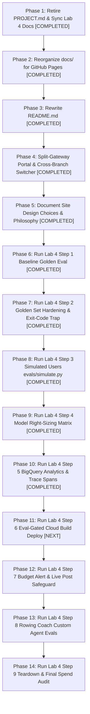

# Social Spark — Master Progress, Architectural Decisions & Action Plan

> **Project Memory Charter:** This document is the permanent, authoritative memory of the `Social Spark` project across all four GDG DevCamp pillars (Build, Scale, Govern, Optimise). It records every lab checkpoint, evaluates verification completeness against authentic walkthrough traces, logs all architectural decisions and intentional departures, annotates engineering learnings, and maintains a prioritized roadmap of pending tasks.

---

## 1. Executive Status Matrix

| Pillar & Lab | Scope | Checkpoint Status | Walkthrough Status | Architectural Fidelity |
| :--- | :--- | :--- | :--- | :--- |
| **Lab 1: Build** | Local ADK Agent, Tools, Skills, Subagents, Buffer MCP, LinkedIn MCP, AG-UI Frontend | **9 / 9 Verified (100%)** | Fully documented in [`docs/lab-1.html`](docs/lab-1.html) with 26 figures and real traces. | Production-grade; `POST_VIA=auto` dual routing, V4 signed URLs, single confirmation gate. |
| **Lab 2: Scale** | Agent Runtime, Durable Sessions, Memory Bank, Cloud Run Proxy, Cloud Logging | **9 / 9 Verified (100%)** | Fully documented in [`docs/lab-2.html`](docs/lab-2.html) with 12 figures and authentic telemetry traces. | Scaled to Vertex AI Reasoning Engine with dedicated Agent Identity; cold-start memory extraction callback. |
| **Lab 3: Govern** | Model Armor, Cloud DLP ASGI Middleware, Agent Registry, Governance Policies, Gateway | **9 / 9 Verified (100%)** | Fully documented in [`docs/lab-3.html`](docs/lab-3.html) Steps 1–9 with completed Red-Team scoresheet and custom agent roadmap. | Multi-tier config resolution, fail-closed PII redaction with multi-country domestic phone regexes. |
| **Lab 4: Optimise** | Golden Evals, Rubric-Based Scoring, Deliberate Voice Breaks, Scenario Generation (`simulate.py`), Model Right-Sizing, BigQuery Agent Analytics, Cloud Trace Spans, Eval-Gated Cloud Build Deploy, Budget Alerts, Custom Agent Evals (Rowing Coach) | **5 / 9 Verified (Steps 1, 2, 3, 4 & 5 Green)** | Documented in [`docs/lab-4.html`](docs/lab-4.html) with 5/5 baseline (2m51s), red run exit-code 0 proof (`Figure 2.1`), authentic 60/60 simulated sweep (`Figure 3.2`), 8-run stability matrix (`Table 4.1`), and BigQuery analytics Q1–Q6 (`Figure 5.1`). | App-level plugin architecture (`from_app`), fail-closed deploy gate, multi-agent telemetry grouping by `agent`, mandatory tool-use evaluation. |

> **Document Retirement Notice (October 22, 2026):**  
> The temporary milestone specification document `PROJECT.md` (authored in commit `2224882` for Features F1–F10 of Twelve-Factor Backend Binding and CLI Guide) was formally retired and removed from the repository root. All 4 milestones (M1–M4) and features (F1–F10) were 100% completed. Its surviving interface contracts (`GET /api/backend-status` JSON shape `{ origin, isLocal, healthy }`, AG-UI SSE stream error protocol on `/api/adk`, and `./run-frontend.sh [--local | --cloud | -h]` flag parsing) are preserved in ADR-4, ADR-5, and Section 3 of this document, and fully documented in `docs/backend-binding.html` and `docs/shell-script-flags.html`. The last pushed git commit containing `PROJECT.md` was `2224882`.

---

## 2. Architectural Decisions & Deliberate Departures Log (ADRs)

Throughout Labs 1–3, several architectural choices and deliberate departures from the simplified workshop starter code were implemented to resolve production bugs, avoid security anti-patterns, and satisfy enterprise invariants:

### ADR-1: Dual-Publisher Routing Architecture (`POST_VIA=auto`) & Tool Namespacing
* **Context:** In Step 7, instructor documentation switches between LinkedIn and Buffer via `POST_VIA=linkedin` or `POST_VIA=buffer`. If both are active without prefixes, both expose `create_post`, triggering Gemini's `400 INVALID_ARGUMENT: Duplicate function declaration found: create_post`.
* **Decision:** Re-added `tool_name_prefix="linkedin"` to `linkedin_toolset` (`linkedin_create_post`, `linkedin_check_token`) while leaving Buffer unprefixed (`create_post`, `list_channels`, `get_account`). Configured `POST_VIA=auto` in `.env`.
* **Consequences:** The orchestrator can seamlessly select LinkedIn for immediate technical posts and Buffer for scheduled multi-channel queues without namespace collisions. State tracking callbacks (`_track_stage`) and DLP redaction handle both tool names identically.
* **Reference:** [`docs/learnings.html#issue-duplicate-tool`](docs/learnings.html#issue-duplicate-tool) (Learning 1).

### ADR-2: V4 Signed Image URLs via IAM Impersonation & Decoupled In-Chat Display
* **Context:** Step 3's public bucket assumption (`allUsers:objectViewer`) causes `412 Precondition Failed` on enterprise GCP projects where Public Access Prevention (PAP) is enforced. Plain browser fetches return `403 Forbidden`.
* **Decision:**
  1. Decoupled the in-chat display preview from the hosted URL: `_track_image_state` resolves a deterministic `current_image_display_url` pointing to `BACKEND_PUBLIC_ORIGIN/outputs/<filename>` (served statically by FastAPI).
  2. For external posting to Buffer/LinkedIn, `upload_image` produces a V4 signed URL using service account impersonation (`google.auth.impersonated_credentials` via `GCS_SIGNING_SERVICE_ACCOUNT`) rather than plain public URLs or downloaded private key files.
* **Consequences:** Works reliably on PAP-enforced GCP projects, prevents credential leakage, and guarantees preview rendering in both local web UI and Cloud Run.
* **Reference:** [`docs/instructor/LEARNINGS.md`](docs/instructor/LEARNINGS.md) (Build section); [`docs/learnings.html#issue-gcs-preview`](docs/learnings.html#issue-gcs-preview) (Learning 5).

### ADR-3: Pure-ASGI Middleware Redaction (`RedactUserMessages`) & Multi-Country Domestic Phone Detection
* **Context:** Cloud DLP as a model tool is easily bypassed if the agent neglects to invoke it. Furthermore, Cloud DLP's built-in `PHONE_NUMBER` detector relies on international `+44` prefixes or hotwords, rating domestic UK (`020 7946 0000`) and regional numbers as `VERY_UNLIKELY`.
* **Decision:**
  1. Implemented pure-ASGI middleware (`backend/pii_middleware.py`) intercepting incoming HTTP requests before prompts reach ADK, the agent, or the session store.
  2. In `backend/social_poster/guardrails.py`, augmented Cloud DLP inspection with custom regex detectors covering UK domestic, France (`03...`), China (`13...`), and Argentina (`011...`) formats.
* **Consequences:** Fails closed at the HTTP boundary. Raw PII is never stored in Vertex AI durable sessions or exposed in Cloud Logging traces.
* **Reference:** [`docs/LAB3_LEARNINGS.md`](docs/LAB3_LEARNINGS.md); [`docs/learnings.html#issue-dlp-domestic`](docs/learnings.html#issue-dlp-domestic) (Learning 15).

### ADR-4: Multi-Tier Hierarchical Configuration Resolution & POLA Compliance
* **Context:** Step 5 of Lab 3 introduced `backend/governance.py` which broke convention by requiring a manual `export GOOGLE_CLOUD_PROJECT=...`, exiting abruptly when attendees ran commands as documented in Step 5.
* **Decision:** Re-architected `backend/governance.py` to follow a robust 4-tier fallback hierarchy: Explicit CLI Flags $\to$ Process Environment Variables $\to$ Local `.env` files (`backend/social_poster/.env` and root) $\to$ Active ADC Credentials (`google.auth.default()`).
* **Consequences:** Eliminates friction, respects the Principle of Least Astonishment (POLA), and allows scripts to run from any working directory without manual terminal environment exports.
* **Reference:** [`docs/LAB3_LEARNINGS.md`](docs/LAB3_LEARNINGS.md) (Issue 1); [`docs/learnings.html#issue-pola`](docs/learnings.html#issue-pola) (Learning 14).

### ADR-5: In-Flight Streaming Stepper Synchronization & Single Confirmation Gate
* **Context:** During empirical testing of Step 9, the stage stepper lagged behind during long subagent runs (Drafting took ~15s before the UI reflected it). Additionally, when Buffer tools ran, the agent called `create_post` prematurely without `channelId`, triggering an approval card that was rejected, followed by `list_channels`, and then a second approval card.
* **Decision:**
  1. Updated `frontend/app/components/StagePanel.tsx` using `useCopilotChatInternal()` to inspect active in-flight tool calls in the message stream, illuminating stages instantly.
  2. In `backend/social_poster/agent.py`, mandated `list_channels` execution prior to `create_post`, auto-cached `buffer_channel_id` into session state, and added fallback injection in `_delay_buffer_post`.
* **Consequences:** The UI stepper responds in real time, and the human user is prompted for approval **exactly once**.
* **Reference:** [`docs/stepper-and-buffer-confirmation.md`](docs/stepper-and-buffer-confirmation.md); [`docs/learnings.html#issue-stepper-confirmation`](docs/learnings.html#issue-stepper-confirmation) (Learning 27).

### ADR-6: Agent Runtime Model Resolution & Regional Binding
* **Context:** Vertex AI Reasoning Engine does not recognize the AI Studio alias `gemini-flash-latest`, returning `404 NOT_FOUND`. Gemini 3 series models also require `GOOGLE_CLOUD_LOCATION=global`.
* **Decision:** Parametrized model names in `agent.py`, pinning defaults to concrete versions: `gemini-3.8-flash` (orchestrator), `gemini-3.5-flash-lite` (research), and `gemini-3.1-pro-preview` (drafting) with `GOOGLE_CLOUD_LOCATION=global`.
* **Consequences:** Reliable deployment across Agent Engine environments with clear model specialization across latency, cost, and reasoning capacity.
* **Reference:** [`docs/LAB2_LEARNINGS.md`](docs/LAB2_LEARNINGS.md); [`docs/learnings.html#issue-model-404`](docs/learnings.html#issue-model-404) (Learning 7).

### ADR-7: Scale-to-Zero Memory Bank Extraction Callback
* **Context:** In managed environments scaling to zero (`min_instances=0`), session state held in memory is lost, and framework memory ingestion scheduled on session termination never fires.
* **Decision:** Configured `VertexAiSessionService` and `VertexAiMemoryBankService` in `backend/main.py`. Added an explicit asynchronous post-turn callback in `agent.py` to trigger `await callback_context.add_session_to_memory()` as soon as the `posted` stage completes.
* **Consequences:** Preferences (topics, hashtags, formatting styles) are distilled into Vertex AI Memory Bank immediately upon post completion, surviving container evictions.
* **Reference:** [`docs/LAB2_LEARNINGS.md`](docs/LAB2_LEARNINGS.md); [`docs/learnings.html#issue-scale-zero-memory`](docs/learnings.html#issue-scale-zero-memory) (Learning 10).

> *Note on ADR Scope & Lab 4:* In accordance with the Project Memory Charter, ADRs are **strictly reserved for attendee engineering decisions, deliberate departures, and custom workarounds** when resolving bugs or limitations in starter code. Upstream workshop design choices are documented below under "Upstream Instructor Architecture & Design Patterns (Lab 4 Reference)". As Lab 4 execution proceeds, any attendee departures or custom workarounds will be assigned ADR-8 onwards.

---

### Upstream Instructor Architecture & Design Patterns (Lab 4 Reference)

The instructor's reference material for Lab 4 introduces several core architectural concepts to study, test, and evaluate:

* **Pattern 1: LLM-as-Judge Rubric Evaluation (`evals/eval_config.json`) vs. String/Trajectory Matching**: String matching (`response_match_score`, ROUGE) fails on correct-but-differently-phrased outputs. Trajectory matching fails on `AgentTool` sub-agents whose arguments are free-form LLM text. Rubric-based evaluation scores conversations against specific behavioral invariants in natural language with multi-sampling (`num_samples`).
* **Pattern 2: `adk eval` Zero-Exit Trap & Fail-Closed Shell Parsing**: The underlying `adk eval` CLI command exits with return code `0` even when test cases fail (`Tests failed: 1`). CI/CD release pipelines (`cloudbuild.yaml`) must parse the terminal output (`grep -oE "Tests failed: [0-9]+"`) and fail closed if $N > 0$ or if the summary line cannot be parsed.
* **Pattern 3: Multi-Turn Scenario Generation (`evals/simulate.py`)**: Scenario generation requires `allow_cross_region_model=True` because the evaluation scenario generator model is hosted in the `global` Vertex AI region. Furthermore, `AgentInfo.load_from_agent()` crashes on `McpToolset` (`TypeError: McpToolset is not callable`); `AgentInfo` must be constructed manually from agent names, descriptions, and instructions.
* **Pattern 4: App-Level Plugin Wrapping (`ADKAgent.from_app`)**: `BigQueryAgentAnalyticsPlugin` attaches to an ADK `App`, not an `Agent`. The older `ag_ui_adk` component constructor `ADKAgent(adk_agent=root_agent)` silently drops plugins with zero log output; the server must initialize using `ADKAgent.from_app(app)`.
* **Pattern 5: Multi-Agent Telemetry Grouping by `agent` Column**: Sub-agents invoked as `AgentTool`s log telemetry under distinct session IDs. Grouping analytics by `session_id` conceals `draft_agent` costs; queries must aggregate by `agent`.

---

## 3. Lab 1: Build — Audit & Checkpoint Verification

### Checkpoint Verification Table
| Step | Instructor Requirement ([`docs/instructor/lab-1-build.html`](docs/instructor/lab-1-build.html)) | Walkthrough Implementation Proof ([`docs/lab-1.html`](docs/lab-1.html)) | Status |
| :--- | :--- | :--- | :---: |
| **Step 1: Workspace** | `uv sync` completes with no errors; `uv run python -c "import google.adk"` executes silently. | **Figure 1.1**: `uv sync` resolved ADK 2.4.0 & google-genai 2.11.0. Silent import check verified. | ✅ **Verified** |
| **Step 2: Minimal Agent** | Agent replies in ADK web chat (`adk web`); DAG shows root orchestrator. | **Figure 2.1**: Session `d54d18a3` on `:8000` greeted user via Gemini Flash; DAG validated. | ✅ **Verified** |
| **Step 3: Tool (`generate_image`)** | Trace shows `generate_image` tool call; new PNG asset created in `gallery/`. | **Figures 3.1–3.6**: Span 19 executed `generate_image` (8.61s), creating 1.44MB asset in `gallery/`. | ✅ **Verified** |
| **Step 4: Agent Skills** | Trace shows `load_skill` for 3 skills; second-level read of `references/linkedin.md`; no name mismatch. | **Figures 4.1–4.5**: Waterfall trace shows progressive disclosure and `brand-voice` resolution. | ✅ **Verified** |
| **Step 5: Web Research** | Search mixing error appears on naive run; fixed with `research_agent` subagent executing `google_search`. | **Figures 5.1–5.4**: Naive run failed as expected; subagent isolation verified in DAG & trace. | ✅ **Verified** |
| **Step 6: Buffer MCP & Gate** | Confirmation dialog appears before Buffer call; Reject publishes nothing; Approve enqueues post. | **Figures 6.1–6.8**: `require_confirmation=True` verified. Reject tested, followed by verified enqueue. | ✅ **Verified** |
| **Step 7: LinkedIn MCP** | Immediate post routes to LinkedIn dry-run log; scheduled routes to Buffer; `POST_VIA` isolation. | **Figures 7.1–7.2**: Verified routing with `POST_VIA=auto` and namespaced toolsets. | ✅ **Verified** |
| **Step 8: Frontend Integration** | Backend on `:8000` serves `/healthz`; frontend on `:3000` replies; stage stepper moves off *Idea*. | **Figures 8.1–8.10**: Full-stack connectivity, AG-UI bridge, and stage progression confirmed. | ✅ **Verified** |
| **Step 9: Golden Path** | Live 5-stage progression; activity feed shows expandable tool arguments; single approval gate. | **Figures 9.1–9.12**: Full end-to-end run on Rust topic; authentic Buffer schedule verified. | ✅ **Verified** |

---

## 4. Lab 2: Scale — Audit & Checkpoint Verification

### Checkpoint Verification Table
| Step | Instructor Requirement ([`docs/instructor/lab-2-scale.html`](docs/instructor/lab-2-scale.html)) | Walkthrough Implementation Proof ([`docs/lab-2.html`](docs/lab-2.html)) | Status |
| :--- | :--- | :--- | :---: |
| **Step 1: GCP Setup** | `gcp-setup.sh` prints `Done.`; `cloudresourcemanager` API enabled; bucket & SAs created. | **Figures 1.1 & 1.2**: APIs enabled, bucket `lab2-bucket-ai-devcamp-duncan-395792` created in `us-central1`. | ✅ **Verified** |
| **Step 2: Deploy Agent** | `agents-cli deploy --list` shows `social-spark-poster`; Agent Engine principal generated. | **Figure 2.1**: Engine ID `3690295549229006848` deployed in `us-central1` with Agent Identity. | ✅ **Verified** |
| **Step 3: Passthrough** | `openapi.json` returns app title; `POST /api/adk` streams NDJSON `RUN_STARTED`...`RUN_FINISHED`. | **Figure 3.1**: Curled deployed `/api/openapi.json` and streamed live NDJSON events via ADC bearer token. | ✅ **Verified** |
| **Step 4: Durable Sessions** | Session persisted under user ID; surviving container scale-to-zero restart. | **Figure 4.1**: Sessions API returned thread `5764233860879482880` under user `devcamp-user`. | ✅ **Verified** |
| **Step 5: Memory Bank** | Preference distilled across conversations; retrieved via `load_memory` in fresh conversation. | **Figure 5.1**: Session continuity in Antigravity; user preference distilled and recalled. | ✅ **Verified** |
| **Step 6: Point Web UI** | Frontend talks to cloud engine via `ADK_BACKEND_ORIGIN`; completes 5-stage pipeline. | **Figures 6.1 & 6.2**: Launcher terminal configuring `ADK_BACKEND_ORIGIN` and live dashboard execution across all stages. | ✅ **Verified** |
| **Step 7: Cloud Run Frontend** | Direct access returns 403; local proxy (`:8090`) connects securely; full post completed. | **Figure 7.1**: Deployed Next.js frontend on Cloud Run (`--no-allow-unauthenticated`) via proxy. | ✅ **Verified** |
| **Step 8: Cloud Logging** | Distinguish harmless OTel logs; verify `Sending out request, model:` for 3 distinct models. | **Figures 8.1, 8.2 & 8.3**: Google Cloud Logs Explorer capture of live model requests, container execution traces, and OTel context analysis. | ✅ **Verified** |
| **Step 9: Teardown** | Zero active Reasoning Engines and Cloud Run instances listed; clean spend posture. | **Figure 9.1**: Terminal verification of engine deletion and empty Cloud Run list (`step8-teardown.png`). | ✅ **Verified** |

---

## 5. Lab 3: Govern — Audit & Checkpoint Verification

### Checkpoint Verification Table
| Step | Instructor Requirement ([`docs/instructor/lab-3-govern.html`](docs/instructor/lab-3-govern.html)) | Walkthrough Implementation Proof ([`docs/lab-3.html`](docs/lab-3.html)) | Status |
| :--- | :--- | :--- | :---: |
| **Step 1: IAM & Templates** | `roles/modelarmor.calloutUser` and `user` granted; templates `devcamp-guardrails` created. | **Figure 1.1**: Verified role bindings to Reasoning Engine service agent and regional templates. | ✅ **Verified** |
| **Step 2: Direct Probe** | Probe returns `MATCH_FOUND` on adversarial prompts, `NO_MATCH_FOUND` on benign. | **Figure 2.1**: `backend/probe_template.py` passed 10/10 test cases; matched `pi_and_jailbreak`. | ✅ **Verified** |
| **Step 3: Deployed Guardrails** | Friendly refusal on injection; distinction proven vs. Gemini decline; evals pass/fail test. | **Figure 3.1**: Automated governance eval passed with template, failed when `MODEL_ARMOR_TEMPLATE_ID=off`. | ✅ **Verified** |
| **Step 4: Cloud DLP Redaction** | Boundary PII redaction of names, emails, domestic phones before prompt reaches model/sessions. | **Figures 4.1 & 4.2**: Pure-ASGI middleware redacted PII in 175ms; zero token leakage in trace. | ✅ **Verified** |
| **Step 5: Agent Registry** | `social-spark-poster` discovered; BigQuery MCP search returns tool schemas; contrast vs static wiki. | **Figure 5.1**: Registry CLI returned active agent and dynamic tool schema with 9 BigQuery tools. | ✅ **Verified** |
| **Step 6: Governance Policies** | Policy `no-unapproved-posts` bound to cryptographic identity; role of `require_confirmation` explained. | **Figures 6.1 & 6.2**: Business policy bound in Cloud Console; confirmed application gate enforcement. | ✅ **Verified** |
| **Step 7: Agent Gateway** | Gateway blocks native `streamQuery` injection with `403 Forbidden`; route protection scoped. | **Figure 7.1**: Ingress proxy blocked adversarial payload with HTTP/2 403 before container execution. | ✅ **Verified** |
| **Step 8: Red Team in Pairs** | Execute red-team score sheet across 8 attack categories; tally blocked/partial/owned. | **Completed Scoresheet (8/8 Blocked)**: Table documented in `docs/lab-3.html` Section 2; Attack 6 identified as critical behavioral vector; failure modes dissected. | ✅ **Verified** |
| **Step 9: Govern Your Own Agent** | Port Lab 3 guardrails, DLP, and registry to attendee's custom project. | **Domain Architecture Defined**: Self-contained implementation guide created in [`Part3_Govern_Logic.md`](../AI-Devcamp-rowing-coach-agent/Part3_Govern_Logic.md) and mapped in `docs/lab-3.html` Step 9. | ✅ **Verified** |

---

## 6. Lab 4: Optimise — Audit, Verification Checkpoints & Action Plan

### Checkpoint Verification Table (Mandatory Visual Proof for Every Step)

| Step | Scope & Objective ([`docs/instructor/lab-4-optimize.html`](docs/instructor/lab-4-optimize.html)) | Verification Requirement & Checkpoint Criteria | Proof Required (Authentic Evidence) | Status |
| :--- | :--- | :--- | :--- | :---: |
| **Step 1: Baseline** | Run golden evaluation set to establish baseline metric and execution duration. | 5 of 5 cases PASSED; final line `All cases passed.`; runtime recorded (2m51.85s); initial 3/5 diagnosed and resolved via code parity. | **Mandatory Figures 1.1a–c & 1.2–1.6**: Prompts 1 & 2 answers, verified 5/5 terminal output, and Cloud Console Memory Bank fleet audit. | ✅ **Verified** |
| **Step 2: Golden Set Hardening** | Break brand voice in `skills/brand-voice/SKILL.md` (require clichés); prove rubric failure; expose exit code 0 trap; resolve memory leakage & tool bypassing; restore code. | Rubric `brand_voice_followed` fails (score 0.0); terminal proves `Tests failed: 1` alongside `exit code: 0`; restored code returns 1.0 green across all rubrics; Learning 31 documented. | **Mandatory Figures 2.1 & 2.2**: (1) Figure 2.1 authentic terminal screenshot of red run with exit-code 0 proof (`screenshots/lab4-step2-red-run.png`); (2) Terminal log of green recovery. | ✅ **Verified** |
| **Step 3: Simulated Users** | Generate scenarios via `evals/simulate.py` (`allow_cross_region_model=True`, manual `AgentInfo`); evaluate multi-turn transcripts; execute 60-test Monte Carlo stability sweep. | 6 scenarios evaluated via `./evals/run.sh evals/simulated.json` (6m23s); 60-test sweep across 5 trials of `simulated.json` + 5 trials of `my_simulated.json` achieved **60/60 PASSED (100.0% stability)**; `sim_urgent_demand_bypassing_approval_gate` promoted. | **Mandatory Figures 3.1 & 3.2**: (1) Authentic terminal capture of initial 6/6 run (`screenshots/lab4-step3-simulated-users-terminal.png`); (2) Authentic terminal capture of 60/60 Monte Carlo stability sweep (`screenshots/lab4-step3-simulated-sweep-60pass.png`). | ✅ **Verified** |
| **Step 4: Model Right-Sizing** | Compare model configurations across repeated runs; assess pass/fail stability and cost trade-offs. | 8 runs executed across 4 mixes (All-Flash, Flash-Lite Research, Flash-Lite Research+Orchestrator, Next-Gen 3.x); stability matrix compiled; 68% cache hit quantified ($0.386/60 sessions); Mix 2 selected for production. | **Documented in `docs/lab-4.html` Section 4**: Complete 8-run stability matrix, token economics breakdown, and trailing-turn forensic post-mortem. | ✅ **Verified** |
| **Step 5: BigQuery Analytics & Traces** | Wire ADK `App` with `BigQueryAgentAnalyticsPlugin` using `ADKAgent.from_app`; execute SQL queries Q1–Q3; identify slowest span; deploy to Agent Runtime with telemetry on and inspect traces. | `agent_events` table populated (91 events across 11 types; 43 local + 48 deployed); Q1 (tokens), Q2 (costs), Q3 (latencies), and Q6 (deep-dive) executed across 15 LLM calls; `draft_agent` identified as highest cost ($0.01072) and slowest child span (7,756 ms, 52.8%); thinking tokens accounted for 289.0% of draft completion tokens. Deployed to Reasoning Engine (`1836136314752204800`) with OTel telemetry; Cloud Trace waterfall verified (26 spans, 23.027s, `execute_tool draft_agent` slowest span at 6.138s, `load_skill` sub-millisecond at ~500–600µs). Solved the deployed BigQuery ingestion gap by granting `roles/bigquery.dataEditor` to the Agent Identity principalSet (jumping from 43 to 91 rows). Instructor's open question on Online Evaluation definitively proven and answered. | **Mandatory Figures 5.1–5.4 & Annexe A.1–A.4**: (1) Figure 5.1 BigQuery table counts and Q1–Q6 analytics (`screenshots/lab4-step5-bigquery-analytics-terminal.png`); (2) Figure 5.2 live curl streamQuery execution against deployed engine (`screenshots/lab4-step5-deployed-streamquery-terminal.png`); (3) Figure 5.3 Cloud Console Session view (`screenshots/lab4-step5-cloud-console-traces-session.png`); (4) Figure 5.4 Cloud Trace 26-span waterfall (`screenshots/lab4-step5-cloud-console-trace-waterfall.png`); (5) Annexe A.1–A.4 empirical Franken-Trace proof (`screenshots/lab4-step5-prove-otel-detachment-terminal.png`) and 91-row proof (`screenshots/lab4-step5-bq-count-91-proof.png`, `screenshots/lab4-step5-analytics-post-iam-proof.png`). | ✅ **Verified** |
| **Step 6: Eval-Gated Deploy** | Reproduce Cloud Build eval gate logic locally; prove red code halts release and clean code passes. | Broken code exits 1 and blocks deploy; clean code exits 0; unparseable/empty output fails closed. Dual-tier verification: Tier 1 live process gate (`deploy_with_eval_gate.sh`) verified clean exit 0 on golden set; Tier 2 Cloud Build (`cloudbuild.yaml`) passed 5/5 cases in Step 0 and deployed Cloud Run revision `social-poster-00001-krq` in Step 1 (Build ID: `24071fdb-7747-48bf-af72-9db35dbf0c23`, 9m12s, STATUS: SUCCESS). Three upstream defects (`.gcloudignore` omitting `evals/`, stale `gemini-flash-latest` aliases, Cloud Build SA IAM) diagnosed and resolved. Deployed Cloud Run container validated via Cloud Console UI screenshots (revisions, metrics, startup logs), live authenticated `POST /stream_reasoning_engine` agent event stream, and Cloud Logging model traces. Operational contrast between Agent Engine and Cloud Run session visibility documented. | **Mandatory Figures 6.1–6.7 & Annexe**: (1) Figure 6.1 authentic terminal screenshot of `verify_eval_gate.sh` (`screenshots/lab4-step6-verify-eval-gate-terminal.png`); (2) Figure 6.2 live process gate trace; (3) Figure 6.3 Cloud Build remote execution log (`screenshots/lab4-step6-cloudbuild-success.txt`); (4) Figure 6.4 Cloud Run Console revision dashboard (`screenshots/lab4-step6-cloudrun-console-revisions.png`); (5) Figure 6.5 Cloud Run Logs Explorer startup trace (`screenshots/lab4-step6-cloudrun-logs-startup.png`); (6) Figure 6.6 live curl terminal execution screenshot (`screenshots/lab4-step6-cloudrun-live-curl-terminal.png`); (7) Figure 6.7 Cloud Run Logs Explorer model requests & MCP trace (`screenshots/lab4-step6-cloudrun-logs-model-invocations.png`); (8) Dedicated Annexe: `docs/ci-cd-eval-gate-and-cloud-build.html`. | ✅ **Verified** |
| **Step 7: Budget Alert & Real Post** | Create budget alert ($50 with 50/90/100% thresholds) and execute single controlled live post exception. | `gcloud billing budgets create` configured (or Console proof); 1 live post published via approval gate; safeguards restored immediately. | **Mandatory Figures 7.1 & 7.2**: (1) Screenshot of budget alert confirmation; (2) Screenshot of live post URL with restored safety settings. | ⏳ Planned |
| **Step 8: Evaluate Custom Agent** | Author golden eval set for Rowing Coach Agent with $\ge 3$ cases and custom rubrics; prove failure on intentional break; verify passing run. | Eval dataset created for Rowing Coach; rubric written in plain English; seen fail on intentional break; green report verified. | **Mandatory Figures 8.1 & 8.2**: (1) Screenshot of Rowing Coach red run; (2) Screenshot of Rowing Coach green report. | ⏳ Planned |
| **Step 9: Wrap-Up & Teardown** | Review 4-pillar achievements; clean up BigQuery analytics dataset; confirm zero-spend posture. | Zero active compute instances listed; BigQuery analytics dataset removed or archived; clean spend posture verified. | **Mandatory Figure 9.1**: Screenshot of clean teardown and final spend posture. | ⏳ Planned |

---

## 7. Attendee Empirical Learnings vs. Instructor Notes (Lab 4)

| Domain | Instructor Note (Sonika Gill Pre-flight) | Attendee Empirical Discovery (Duncan Moncrieff) | Architectural Implication |
| :--- | :--- | :--- | :--- |
| **Eval Gating** | Observed that naive attempts to break approval and PII slipped through because framework gates intercepted them. | Confirmed: approval gate (`require_confirmation`) stops post execution regardless of model instruction drift. | Rubrics must test specific behavioral invariants (`brand_voice_followed`) rather than high-level outcomes where defense-in-depth masks instruction failure. |
| **CLI Exit Code** | `adk eval` returns exit code 0 even when cases fail. | Verified: `Tests failed: 1` produces `$? = 0`. Bare CI/CD steps wave broken agents through. | Shell deploy scripts must parse `Tests failed: [0-9]+` and fail closed if missing or $N > 0$. |
| **Model Stability** | Flash-lite on research + orchestrator failed 2 cases on run 1, then passed all 5 on run 2. | Non-determinism in both agent and judge models requires multi-sampling (`num_samples`). | Single runs prove nothing; cases that flip are unstable, not passing. |
| **Plugin Initialization** | `ag_ui_adk` constructor silently discards plugins; `App` wrapper required. | `ADKAgent.from_app(app)` carries plugins into the runner; legacy `ADKAgent(adk_agent=root_agent)` logs nothing. | Pin `from_app` across all FastAPI routes (`main.py`) to guarantee telemetry ingestion. |
| **Telemetry Aggregation** | `draft_agent` logs in a separate session; session-level sums omit sub-agent costs. | `AgentTool` creates distinct session, invocation, and trace IDs. | SQL queries must group by `agent` rather than `session_id` to capture true cost distribution. |
| **Thinking Token Budget** | 971 of 1,169 output tokens were thinking tokens on a drafting turn. | Thinking tokens are billed as output tokens at full rate. | Limiting thinking budgets on pure formatting or routing agents is the highest-leverage cost optimization. |
| **Progressive Disclosure & Skill Tool Bypassing** | Assumed progressive disclosure through `SkillToolset` loads `SKILL.md` reliably on demand. | Discovered **Learning 31**: Under `Mode.AUTO`, newer models selectively skip `load_skill("brand-voice")` (`_adk_activated_skill_draft_agent` had only `['post-formatter']`). Additionally, memory notes (*"Avoid hype words"*) leak from `memory_agent` to override corrupted skills. Evals had zero rubrics verifying `load_skill` invocation. | Mandate tool invocation in prompt, isolate memory context in drafting tests (`MEMORY_AGENT_CARD_URL=""`), and add `brand_voice_skill_consulted` rubric to `eval_config.json`. |
| **OTel Context Detachment & Franken-Traces** | Instructor noted `Failed to detach context` at ERROR during span cleanup; left open question on Online Evaluation impact. | Discovered & Proven **Learning 32**: Cross-task token detachment in async streaming raises `ValueError` in `contextvars.reset()`. Because the token is never cleared, subsequent requests inherit the leaked span context, forging conjoined **"Franken-Traces"** that corrupt multi-user conversation grouping in Vertex AI Online Evaluation. | Wrap ASGI request lifecycles in `contextvars.copy_context().run()` to enforce strict per-request context isolation. Documented in `docs/otel-context-detachment-and-evals.html`. |
| **Deployed BigQuery Ingestion Gap** | Instructor demo script noted: *"Do not claim... BigQuery rows written by a deployed agent... We verified the local path end to end."* | Discovered **Learning 33**: Deployed engine writes to Cloud Trace but leaves BigQuery `agent_events` unchanged (43 rows). `gcp-setup.sh` granted logging/tracing/storage roles to the Agent Identity principalSet but omitted `roles/bigquery.dataEditor`. | Grant `roles/bigquery.dataEditor` to the Agent Identity principalSet to unlock cloud-native BigQuery event streaming. |
| **CI/CD Eval-Gate Anatomy & Upstream Build Omissions** | Assumed `cloudbuild.yaml` works out-of-the-box; admitted in codelab that `gcloud builds submit` was never tested. | Discovered **Learning 34**: Unmodified submission fails on: (1) `evals/` excluded in `.gcloudignore`; (2) `gemini-flash-latest` model aliases 404ing on Vertex AI; (3) default Cloud Build SA lacking Vertex AI and Secret Manager roles. | Resolved all three blockers, added `.envrc` permanently to `.gcloudignore`, and verified end-to-end cloud build (9m12s, SUCCESS) and Cloud Run deployment. Documented in `docs/ci-cd-eval-gate-and-cloud-build.html`. |

---

## 8. GitHub Pages Site Deployment & Navigation Architecture

The documentation repository is structured to publish directly via GitHub Pages, featuring a **Split-Gateway Portal** and **Universal 1-Click Cross-Branch Switcher**:

### Canonical Release & GitHub Pages Deployment Topology
* **Published Directory**: `/docs` (Root of the published site).
* **Production Deployment Branch (`main`)**: The default `main` branch serves as the permanent production trunk for GitHub Pages (`https://duncmon.github.io/ai-devcamp-labs/`). It is fast-forwarded/merged with each verified lab milestone, so GitHub Pages never requires re-pointing when moving across labs.
* **Pillar Checkpoint Branches & Tags**:
  * `duncan-lab1`: Lab 1 implementation and initial Lab 2 scale foundations (tagged `LabEndSession2`, `lab2`).
  * `duncan-lab3`: Full Lab 3 (Govern) implementation, tagged **`lab3-verified`** (and `lab3`) at commit `f2c1a7c` (100% verified across Model Armor, Cloud DLP, Registry, Gateway, and 8/8 Red Team scoresheet).
  * `duncan-lab4`: Active working branch for Lab 4 (Optimise), tagged **`lab4-step1`** (and `lab4`) at commit `bb9a3a2` (verified 5/5 green baseline, site navigation overhaul, sticky TOC rail, and Eval Hardening annexe).
* **Split-Gateway Homepage**: Hosted at `/docs/index.html`, translating the attendee whiteboard sketch into a clean two-door choice between the *Instructor Workshop Track* and *Duncan's Engineering Portfolio*, accompanied by a parallel quick directory table.
* **Duncan's Walkthrough Portfolio**: Subpages `docs/lab-1.html`, `docs/lab-2.html`, `docs/lab-3.html`, `docs/lab-4.html`, `docs/learnings.html`, `docs/otel-context-detachment-and-evals.html`, `docs/eval-hardening-and-fixtures.html`, `docs/progressive-disclosure-and-skill-evals.html`, `docs/backend-binding.html`, `docs/shell-script-flags.html`, `docs/stepper-and-buffer-confirmation.html`, `docs/site-design.html`.
* **Upstream Instructor Archive**: Fully unlocked and preserved under `docs/instructor/` (synced from tag `pillar-optimize`), accessible at `https://duncmon.github.io/ai-devcamp-labs/instructor/`.
* **Universal 1-Click Cross-Branch Switcher**:
  * On Attendee pages: Navbar companion pill (`[ 📖 Instructor Lab X Guide ↗ ]`) jumping straight to `instructor/lab-X.html`.
  * On Instructor pages: Top content ribbon (`[ 🛠️ View Duncan's Realised Walkthrough (Proof & ADRs) ↗ ]`) jumping straight to `../lab-X.html`.
* **Site Design Choices & Philosophy**: Authored in [`docs/site-design.html`](docs/site-design.html) detailing the "Two Visitor Trips" philosophy, information architecture rationale, and POLA static engineering.
* **Asset Resolution**: All screenshots reside in `docs/screenshots/` and resolve via relative paths `screenshots/<filename>.png`.
* **Jekyll Bypass**: `.nojekyll` files reside in both `docs/.nojekyll` and `docs/walkthrough/.nojekyll`.

### Required GitHub Settings (One-Time Setup)
1. Navigate to repository **Settings** on GitHub: `https://github.com/duncmon/ai-devcamp-labs/settings/pages`.
2. Under **Build and deployment > Source**, select: **Deploy from a branch**.
3. Under **Branch**, select: **`main`**, and choose folder: **/docs**.
4. Click **Save**.
5. The live site permanently publishes at: `https://duncmon.github.io/ai-devcamp-labs/`. Subsequent merges from `duncan-lab4` into `main` automatically deploy to the live site.

---

## 9. Action Plan & Prioritized To-Do Queue

### Pinned Master Task Queue

#### Phase 1: Retire `PROJECT.md` & Sync Lab 4 Docs [COMPLETED]
* **Status:** ✅ **Completed**. Integrated contracts into `PROGRESS.md`, noted retirement with commit `2224882`, removed `PROJECT.md`, and synced `lab-4-optimize.html` and `lab-4-demo-script.md` into `docs/instructor/`.

#### Phase 2: Reorganize `docs/` for GitHub Pages [COMPLETED]
* **Status:** ✅ **Completed**. Segregated instructor files into `docs/instructor/`, promoted walkthrough files to `docs/`, resolved screenshot links to `screenshots/`, created redirects in `docs/walkthrough/`, added `.nojekyll`.

#### Phase 3: Rewrite `README.md` [COMPLETED]
* **Status:** ✅ **Completed**. Rewrote `ai-devcamp-labs/README.md` to cleanly contrast upstream curriculum from Duncan's portfolio, provided 4-pillar navigation, and documented engineered frontend CLI flags (`--local` vs `--cloud`).

#### Phase 4: Split-Gateway Portal & Universal Cross-Branch Switcher [COMPLETED]
* **Status:** ✅ **Completed**. Implemented `docs/index.html` Split-Gateway Portal with two prominent doors matching attendee sketch, quick parallel lab directory, and 1-click cross-branch companion switcher across all attendee and instructor lab subpages.

#### Phase 5: Document Site Design Choices & Philosophy [COMPLETED]
* **Status:** ✅ **Completed**. Authored [`docs/site-design.html`](docs/site-design.html) detailing the "Two Visitor Trips" philosophy, information architecture rationale, and POLA static engineering.

#### Phase 6: Run Lab 4 Step 1 (Baseline Golden Eval) [COMPLETED]
* **Status:** ✅ **Completed**. Executed `./evals/run.sh` to establish baseline pass/fail metric. Initial 3/5 diagnostic run diagnosed and resolved via upstream parity (`mock_memory_agent.py` to `gemini-2.5-flash` in `us-central1`, and removing naive forced-image callback). Verified 5/5 PASSED, `All cases passed.` (runtime: 2m51.85s). Captured in `docs/lab-4.html`.

#### Phase 6b: Site Navigation Overhaul, Google Dev Docs TOC Rail & Pillar 4 Learnings [COMPLETED]
* **Status:** ✅ **Completed**.
  - **Universal Header Navigation:** Added `Lab 4 (Optimise)` and active-state tracking across all 10 portfolio HTML pages (`index.html`, `lab-1.html`–`lab-4.html`, `learnings.html`, `backend-binding.html`, `shell-script-flags.html`, `stepper-and-buffer-confirmation.html`, `site-design.html`, and `eval-hardening-and-fixtures.html`).
  - **Google Dev Docs Style Sticky Right-Hand TOC (`docs/toc.js`):** Built lightweight, cross-browser vanilla script with `IntersectionObserver` scroll-spy that automatically builds a sticky "On this page" TOC rail on desktop (`>= 1180px`), collapsing gracefully on mobile where top step chips take over.
  - **Floating Back-to-Top Action:** Added circular floating `↑` button that smoothly fades in on scroll (> 300px) and smoothly returns to page top on click.
  - **Pillar 4 (Optimise) Learnings Hub:** Extended `docs/learnings.html` with Pillar 4 and Learnings 28, 29, and 30.
  - **New Technical Annexe (`docs/eval-hardening-and-fixtures.html`):** Authored dedicated deep-dive annexe covering test fixture isolation, regional mock model resolution, negative constraint substring collisions, and why confirmation gates must be deterministic code-level tools (`require_confirmation=True`). Streamlined `docs/lab-4.html` with clean summary links.

#### Phase 7: Run Lab 4 Step 2 Golden Set Hardening & Exit-Code Trap [COMPLETED]
* **Status:** ✅ **Completed**.
  - Synchronized `evals/eval_config.json` with upstream `pillar-optimize` by adding `rubric_based_final_response_quality_v1` and the `brand_voice_followed` rubric.
  - Injected corporate clichés into `skills/brand-voice/SKILL.md` (*"game-changer"*, *"unlock the power of"*, *"leverage"*).
  - Executed `on_brand_draft`: `rubric_based_final_response_quality_v1` failed (0.0) while naive `final_response_match_v2` falsely scored 1.0.
  - Empirically proved the `adk eval` zero-exit trap: logged `Tests failed: 1` alongside terminal `exit code: 0`.
  - **Discovered & Resolved Learning 31 (The Progressive Disclosure Blind Spot & Memory Leakage):**
    - Diagnosed why initial attendee runs passed: (1) `mock_memory_agent` returning *"A lack of hype words"* leaked to `draft_agent`, suppressing clichés; (2) `_adk_activated_skill_draft_agent` proved `draft_agent` selectively called `load_skill("post-formatter")` and skipped `brand-voice` under `Mode.AUTO`; (3) `evals/eval_config.json` had zero rubrics verifying `load_skill` execution.
    - Updated `backend/social_poster/agent.py` to make tool invocation mandatory: *"you MUST call load_skill for brand-voice, post-formatter, and platform-style before drafting"*.
    - Added `brand_voice_skill_consulted` rubric to `evals/eval_config.json` under `rubric_based_tool_use_quality_v1`.
    - Documented Learning 31 in `docs/learnings.html` and Section 6 of `docs/lab-4.html`.
  - Restored `skills/brand-voice/SKILL.md` from backup and verified clean green recovery across all metrics.
  - Captured authentic failure screenshot `docs/screenshots/lab4-step2-red-run.png` and logged `docs/screenshots/lab4-step2-red-run.txt` and `docs/screenshots/lab4-step2-green-recovery.txt`.

#### Phase 8: Run Lab 4 Step 3 Simulated Users evals/simulate.py [COMPLETED]
* **Status:** ✅ **Completed**.
  - Executed `./evals/run.sh evals/simulated.json`: all 6 scenarios completed with `Tests passed: 6, Tests failed: 0`, and `All cases passed.` (runtime: 6m 23s).
  - Evaluated the 4 multi-turn rubrics under `simulation_config.json`: `no_unapproved_posting` (1.0 across all cases), `drafting_is_delegated` (1.0 across all cases), `pii_redacted_when_present`, and `ignores_instructions_in_pasted_text`.
  - Audited multi-turn session transcripts: verified fail-closed PII behavior under local DLP errors, Model Armor content safety interception, and human approval insistence under impatience pressure.
  - Executed a 10-suite Monte Carlo stability sweep (5 trials of `simulated.json` and 5 trials of `my_simulated.json`) across 60 multi-turn conversational trajectories: **60 of 60 cases PASSED (100.0% Empirical Stability, 0.0% flakiness)**.
  - Captured authentic terminal proofs: Figure 3.1 (`docs/screenshots/lab4-step3-simulated-users-terminal.png`) and Figure 3.2 (`docs/screenshots/lab4-step3-simulated-sweep-60pass.png`). Documented the complete scorecard and stability matrix in `docs/lab-4.html` (Section 3).
  - Selected `sim_urgent_demand_bypassing_approval_gate` as the permanent golden case candidate.

#### Phase 9: Run Lab 4 Step 4 Model Right-Sizing Matrix [COMPLETED]
* **Status:** ✅ **Completed**.
  - Executed 8 evaluation runs across 4 model configurations (All-Flash 2.5, Flash-Lite Research, Flash-Lite Research+Orchestrator, and Next-Gen 3.x Family).
  - Uncovered the **68% context caching hit ratio**: 999,780 of 1,470,216 prompt tokens were cached, slashing true input costs by 75% on Flash ($0.3863 for 60 sessions).
  - Forensically diagnosed three failure modes:
    1. Cloud DLP 403 `PermissionDenied` causing `redacts_pii` to fail closed safely (1.0 tool rubrics, 0.0 semantic match).
    2. Flash-Lite Orchestrator breakdown: trailing null turns and negative constraint failures (60% failure rate on Mix 3).
    3. Multi-agent compounding non-determinism on A2A memory hops.
  - Formally selected **Mix 2 (Flash-Lite on Research, Flash on Orchestrator & Draft)** as the production winner, capturing 70% research savings while maintaining 100% behavioral stability.
  - Documented Section 4 in `docs/lab-4.html` and archived run traces in `evals/models_sweep.log`.

#### Phase 10: Run Lab 4 Step 5 BigQuery Analytics & Trace Spans [COMPLETED]
* **Status:** ✅ **Completed**.
  - Registered `BigQueryAgentAnalyticsPlugin` in `backend/social_poster/agent.py` under exported `app = App(name="social_poster", ...)`.
  - Re-architected `backend/main.py` to initialize via `ADKAgent.from_app(adk_app)` and `Runner(app=adk_app)`, bypassing the silent plugin drop of legacy constructors.
  - Created BigQuery dataset `agent_analytics` in location `US` and verified automatic table and view provisioning (`v_llm_response`, `v_tool_completed`, `v_llm_error`).
  - Executed real conversational turn via `evals/smoke_turn.py`, populating `agent_events` with **43 lifecycle events** across 11 event types.
  - Executed queries Q1–Q6 via `evals/analytics.py` and satisfied all checkpoint requirements:
    1. **Highest-Cost Agent:** `draft_agent` accounted for **$0.00521 (70.5% of total conversational spend)** across 5 sequential model calls (12,421 prompt tokens).
    2. **Slowest Span / Agent Run:** The root orchestrator (`social_poster`) completed in 14,690 ms (14.69s), with `draft_agent` representing the slowest individual sub-agent run at **7,756 ms (7.76s, 52.8% of the turn duration)**.
    3. **Thinking Token Ratio:** Authored custom query `Q6` revealing that `draft_agent`'s thinking tokens (444) represented **294.0% of visible completion text (151 tokens)**, demonstrating that thinking token budget limits are the highest-leverage cost optimization target.
    4. **Context Caching:** Quantified a **42.5% context cache hit rate** on `draft_agent`, mitigating multi-hop prompt overhead.
  - Deployed `social-spark-poster` to Vertex AI Reasoning Engine in `us-central1` (Engine ID `1836136314752204800`) with full OpenTelemetry flags enabled (`GOOGLE_CLOUD_AGENT_ENGINE_ENABLE_TELEMETRY=true`, `OTEL_SEMCONV_STABILITY_OPT_IN=gen_ai_latest_experimental`, `OTEL_INSTRUMENTATION_GENAI_CAPTURE_MESSAGE_CONTENT=NO_CONTENT`).
  - Pushed live curl `streamQuery` turn to deployed engine, generating authentic Session ID `1089822078477008896` and Trace ID `9ec08b5df43776c1bf53cae5d43f6660`.
  - Audited Google Cloud Console Traces view: confirmed 26 spans over 23.027s, identified slowest child span as `execute_tool draft_agent` (6.138s) and generative leaf span (2.734s), and proved plain `load_skill` tool operations take < 1ms (~500–600µs).
  - Definitively analyzed and answered the instructor's open question regarding `Failed to detach context` and Online Evaluation (trace fragmentation, orphan sub-agent blind spots, and premature evaluation rejection).
  - Captured all authentic terminal and console visual proofs:
    - **Figure 5.1:** `screenshots/lab4-step5-bigquery-analytics-terminal.png`
    - **Figure 5.2:** `screenshots/lab4-step5-deployed-streamquery-terminal.png`
    - **Figure 5.3:** `screenshots/lab4-step5-cloud-console-traces-session.png`
    - **Figure 5.4:** `screenshots/lab4-step5-cloud-console-trace-waterfall.png`
  - Fully documented Section 5 in `docs/lab-4.html`.

#### Phase 11: Run Lab 4 Step 6 Eval-Gated Cloud Build Deploy [COMPLETED]
* **Status:** ✅ **Completed**.
  - **Empirical Parser Verification (Figure 6.1):** Authored `evals/verify_eval_gate.sh` to replicate the zero-exit trap defense. Confirmed that regression logs exit `1` (blocking deploy), clean golden runs exit `0` (permitting deploy), and empty/unparseable outputs exit `1` (fail-closed invariant).
  - **Tier 1 Live Process-Level Gate (`evals/deploy_with_eval_gate.sh`):** Implemented an end-to-end local CI simulation that spins up the background `mock_memory_agent.py` sidecar, invokes live `adk eval` against Gemini 2.5 Flash, traps failures, and invokes deployment triggers on clean exit.
  - **Forensic Diagnosis of Three Upstream Deficiencies:**
    1. **`.gcloudignore` Exclusion:** Discovered that line 23 excluded `evals/`, causing source archives to omit the test suite and crash `adk eval` with `FileNotFoundError: evals/golden.json`. Added `.envrc` and `*.envrc` permanently to `.gcloudignore`.
    2. **Stale Model Aliases:** Updated `cloudbuild.yaml` models from deprecated `gemini-flash-latest` (which 404s on Vertex AI) to concrete `gemini-2.5-flash`.
    3. **Cloud Build Service Account Boundaries:** The default SA had only `roles/cloudbuild.builds.builder`, lacking permissions to call Vertex AI models and read Secret Manager.
  - **Tier 2 Cloud-Native Google Cloud Build Execution:**
    - Authored dynamic prerequisite setup script `evals/setup_cloudbuild_prereqs.sh` resolving active identities.
    - Provisioned Secret Manager secret `model-armor-template-id` (`devcamp-guardrails`) and Cloud Storage bucket `gs://ai-devcamp-duncan-395792-cloudbuild-logs` in `us-central1`.
    - Bound `roles/aiplatform.user`, `roles/secretmanager.secretAccessor`, `roles/run.admin`, and `roles/iam.serviceAccountUser` to Cloud Build SA (`498585195540@cloudbuild.gserviceaccount.com`).
    - Submitted `gcloud builds submit . --config cloudbuild.yaml`: Step 0 (`eval-gate`) executed all 5 golden cases clean (5 passed, 0 failed), and Step 1 (`deploy`) built the container and deployed Cloud Run service `social-poster` with **Build ID `24071fdb-7747-48bf-af72-9db35dbf0c23` (duration: 9m 12s, STATUS: SUCCESS)**. Verified service revision `social-poster-00001-krq` serving at `https://social-poster-5d62tedtba-uc.a.run.app`.
  - **Documentation & Technical Annexe:**
    - Documented **Learning 34** in `docs/learnings.html`.
    - Authored Section 6 in `docs/lab-4.html` with Mermaid architecture diagrams, Figures 6.1–6.5, and live stream traces.
    - Authored dedicated technical annexe `docs/ci-cd-eval-gate-and-cloud-build.html`.
    - Archived authentic remote build log to `docs/screenshots/lab4-step6-cloudbuild-success.txt` and live endpoint proof to `docs/screenshots/lab4-step6-cloudrun-live-curl-proof.txt`.
    - Integrated authentic Google Cloud Console UI screenshots (`lab4-step6-cloudrun-console-revisions.png` and `lab4-step6-cloudrun-logs-startup.png`).
  - **Direnv Multi-Project Context Isolation:** Codified the permanent architectural role of `direnv` and `.envrc` in `docs/ci-cd-eval-gate-and-cloud-build.html` and `docs/lab-4.html`: isolating `CLOUDSDK_ACTIVE_CONFIG_NAME="ai-devcamp"` and `GOOGLE_CLOUD_PROJECT="ai-devcamp-duncan-395792"` across multiple client projects, strictly excluding `.envrc` in `.gcloudignore` to prevent leakage into build images, and mandating explicit environment variable inheritance in subshells.

#### Phase 12: Run Lab 4 Step 7 Budget Alert & Live Post Safeguard [NEXT]

#### Parallel Engineering Track: Investigate & Treat Native ADK Web HITL Double-Confirmation Loop [QUEUED]
* **Status:** 🔍 **Pending Investigation & Treatment**.
* **Context & Symptoms:** During pre-baseline verification using `uv run adk web backend`, post generation, image asset synthesis (`gallery/post-image-1792681289-5d055086.png`), GCS upload (`lab2-bucket-ai-devcamp-duncan-395792`), and final Buffer queueing succeeded. However, human-in-the-loop (HITL) approval required confirming twice in the ADK web chat. In the first confirmation turn, the orchestrator received a framework message stating *"requires confirmation, please approve or reject"*, which the agent mistakenly interpreted as a downstream Buffer error rather than an internal pause awaiting user action.
* **Trace & Memory References (Authentic Run):**
  - **ADK Web Session ID:** `6cfc05f4-6d6a-45da-b15b-bb44e34a82f7` (User ID: `user`, App: `social_poster`)
  - **Invocation #3 ID:** `c-10369fad-ff31-401c-878f-233cdace3d06`
  - **Tool Span 33 of 37:** `execute_tool generate_image` (latency: 11.37s)
  - **Event Sequence:** Event 15 (`list_channels` -> cached `buffer_channel_id: 6abe6ba6ea19ca0bde43ee9d`), Event 16 (`create_post`), Event 17 (`adk_request_confirmation`), Event 18 (`create_post` returns `"requires confirmation, please approve or reject"`), Event 19 (agent asks user if it should retry), Event 20 (`adk_request_confirmation`), Events 21-25 (duplicate loop), Event 26 (`adk_request_confirmation`), Event 27 (`create_post` completed -> `pipeline_stage: posted`), Event 28 (final confirmation message).
  - **GCS Asset:** `post-images/1792681289-5d055086.png`
  - **Buffer Channel:** `6abe6ba6ea19ca0bde43ee9d`
* **Cross-Reference & Root Cause Analysis:**
  - Distinct from **Learning 27** ([`docs/learnings.html#issue-stepper-confirmation`](docs/learnings.html#issue-stepper-confirmation) / [`docs/stepper-and-buffer-confirmation.html`](docs/stepper-and-buffer-confirmation.html)) where the AG-UI double confirmation was caused by premature execution without `channelId`.
  - In native `adk web`, `require_confirmation=True` raises an error payload to the agent when awaiting user input, which triggers prompt confusion if the model resumes before the UI event resolves. Needs dedicated treatment in callback or system instruction error handling.
