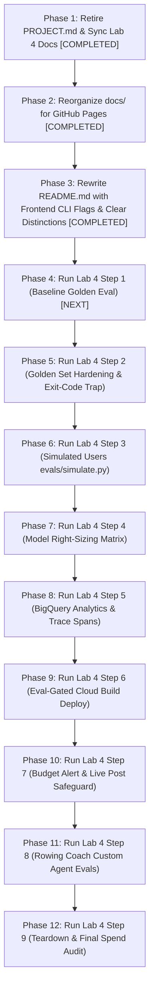

# Social Spark — Master Progress, Architectural Decisions & Action Plan

> **Project Memory Charter:** This document is the permanent, authoritative memory of the `Social Spark` project across all four GDG DevCamp pillars (Build, Scale, Govern, Optimise). It records every lab checkpoint, evaluates verification completeness against authentic walkthrough traces, logs all architectural decisions and intentional departures, annotates engineering learnings, and maintains a prioritized roadmap of pending tasks.

---

## 1. Executive Status Matrix

| Pillar & Lab | Scope | Checkpoint Status | Walkthrough Status | Architectural Fidelity |
| :--- | :--- | :--- | :--- | :--- |
| **Lab 1: Build** | Local ADK Agent, Tools, Skills, Subagents, Buffer MCP, LinkedIn MCP, AG-UI Frontend | **9 / 9 Verified (100%)** | Fully documented in [`docs/lab-1.html`](docs/lab-1.html) with 26 figures and real traces. | Production-grade; `POST_VIA=auto` dual routing, V4 signed URLs, single confirmation gate. |
| **Lab 2: Scale** | Agent Runtime, Durable Sessions, Memory Bank, Cloud Run Proxy, Cloud Logging | **9 / 9 Verified (100%)** | Fully documented in [`docs/lab-2.html`](docs/lab-2.html) with 12 figures and authentic telemetry traces. | Scaled to Vertex AI Reasoning Engine with dedicated Agent Identity; cold-start memory extraction callback. |
| **Lab 3: Govern** | Model Armor, Cloud DLP ASGI Middleware, Agent Registry, Governance Policies, Gateway | **9 / 9 Verified (100%)** | Fully documented in [`docs/lab-3.html`](docs/lab-3.html) Steps 1–9 with completed Red-Team scoresheet and custom agent roadmap. | Multi-tier config resolution, fail-closed PII redaction with multi-country domestic phone regexes. |
| **Lab 4: Optimise** | Golden Evals, Rubric-Based Scoring, Deliberate Voice Breaks, Scenario Generation (`simulate.py`), Model Right-Sizing, BigQuery Agent Analytics, Cloud Trace Spans, Eval-Gated Cloud Build Deploy, Budget Alerts, Custom Agent Evals (Rowing Coach) | **0 / 9 Active (Action Plan Defined)** | Pre-flight documented; instructor curriculum synced to `docs/instructor/lab-4-optimize.html`. | App-level plugin architecture (`from_app`), fail-closed deploy gate, multi-agent telemetry grouping by `agent`. |

> **Document Retirement Notice (October 22, 2026):**  
> The temporary milestone specification document `PROJECT.md` (authored in commit `2224882` for Features F1–F10 of Twelve-Factor Backend Binding and CLI Guide) was formally retired and removed from the repository root. All 4 milestones (M1–M4) and features (F1–F10) were 100% completed. Its surviving interface contracts (`GET /api/backend-status` JSON shape `{ origin, isLocal, healthy }`, AG-UI SSE stream error protocol on `/api/adk`, and `./run-frontend.sh [--local | --cloud | -h]` flag parsing) are preserved in ADR-4, ADR-5, and Section 3 of this document, and fully documented in `docs/backend-binding.html` and `docs/shell-script-flags.html`. The last pushed git commit containing `PROJECT.md` was `2224882`.

---

## 2. Architectural Decisions & Deliberate Departures Log (ADRs)

Throughout Labs 1–3, several architectural choices and deliberate departures from the simplified workshop starter code were implemented to resolve production bugs, avoid security anti-patterns, and satisfy enterprise invariants:

### ADR-1: Dual-Publisher Routing Architecture (`POST_VIA=auto`) & Tool Namespacing
* **Context:** In Step 7, instructor documentation switches between LinkedIn and Buffer via `POST_VIA=linkedin` or `POST_VIA=buffer`. If both are active without prefixes, both expose `create_post`, triggering Gemini's `400 INVALID_ARGUMENT: Duplicate function declaration found: create_post`.
* **Decision:** Re-added `tool_name_prefix="linkedin"` to `linkedin_toolset` (`linkedin_create_post`, `linkedin_check_token`) while leaving Buffer unprefixed (`create_post`, `list_channels`, `get_account`). Configured `POST_VIA=auto` in `.env`.
* **Consequences:** The orchestrator can seamlessly select LinkedIn for immediate technical posts and Buffer for scheduled multi-channel queues without namespace collisions. State tracking callbacks (`_track_stage`) and DLP redaction handle both tool names identically.
* **Reference:** [`docs/learnings.html#issue-duplicate-tool`](docs/learnings.html#issue-duplicate-tool) (Learning 1).

### ADR-2: V4 Signed Image URLs via IAM Impersonation & Decoupled In-Chat Display
* **Context:** Step 3's public bucket assumption (`allUsers:objectViewer`) causes `412 Precondition Failed` on enterprise GCP projects where Public Access Prevention (PAP) is enforced. Plain browser fetches return `403 Forbidden`.
* **Decision:**
  1. Decoupled the in-chat display preview from the hosted URL: `_track_image_state` resolves a deterministic `current_image_display_url` pointing to `BACKEND_PUBLIC_ORIGIN/outputs/<filename>` (served statically by FastAPI).
  2. For external posting to Buffer/LinkedIn, `upload_image` produces a V4 signed URL using service account impersonation (`google.auth.impersonated_credentials` via `GCS_SIGNING_SERVICE_ACCOUNT`) rather than plain public URLs or downloaded private key files.
* **Consequences:** Works reliably on PAP-enforced GCP projects, prevents credential leakage, and guarantees preview rendering in both local web UI and Cloud Run.
* **Reference:** [`docs/instructor/LEARNINGS.md`](docs/instructor/LEARNINGS.md) (Build section); [`docs/learnings.html#issue-gcs-preview`](docs/learnings.html#issue-gcs-preview) (Learning 5).

### ADR-3: Pure-ASGI Middleware Redaction (`RedactUserMessages`) & Multi-Country Domestic Phone Detection
* **Context:** Cloud DLP as a model tool is easily bypassed if the agent neglects to invoke it. Furthermore, Cloud DLP's built-in `PHONE_NUMBER` detector relies on international `+44` prefixes or hotwords, rating domestic UK (`020 7946 0000`) and regional numbers as `VERY_UNLIKELY`.
* **Decision:**
  1. Implemented pure-ASGI middleware (`backend/pii_middleware.py`) intercepting incoming HTTP requests before prompts reach ADK, the agent, or the session store.
  2. In `backend/social_poster/guardrails.py`, augmented Cloud DLP inspection with custom regex detectors covering UK domestic, France (`03...`), China (`13...`), and Argentina (`011...`) formats.
* **Consequences:** Fails closed at the HTTP boundary. Raw PII is never stored in Vertex AI durable sessions or exposed in Cloud Logging traces.
* **Reference:** [`docs/LAB3_LEARNINGS.md`](docs/LAB3_LEARNINGS.md); [`docs/learnings.html#issue-dlp-domestic`](docs/learnings.html#issue-dlp-domestic) (Learning 15).

### ADR-4: Multi-Tier Hierarchical Configuration Resolution & POLA Compliance
* **Context:** Step 5 of Lab 3 introduced `backend/governance.py` which broke convention by requiring a manual `export GOOGLE_CLOUD_PROJECT=...`, exiting abruptly when attendees ran commands as documented in Step 5.
* **Decision:** Re-architected `backend/governance.py` to follow a robust 4-tier fallback hierarchy: Explicit CLI Flags $\to$ Process Environment Variables $\to$ Local `.env` files (`backend/social_poster/.env` and root) $\to$ Active ADC Credentials (`google.auth.default()`).
* **Consequences:** Eliminates friction, respects the Principle of Least Astonishment (POLA), and allows scripts to run from any working directory without manual terminal environment exports.
* **Reference:** [`docs/LAB3_LEARNINGS.md`](docs/LAB3_LEARNINGS.md) (Issue 1); [`docs/learnings.html#issue-pola`](docs/learnings.html#issue-pola) (Learning 14).

### ADR-5: In-Flight Streaming Stepper Synchronization & Single Confirmation Gate
* **Context:** During empirical testing of Step 9, the stage stepper lagged behind during long subagent runs (Drafting took ~15s before the UI reflected it). Additionally, when Buffer tools ran, the agent called `create_post` prematurely without `channelId`, triggering an approval card that was rejected, followed by `list_channels`, and then a second approval card.
* **Decision:**
  1. Updated `frontend/app/components/StagePanel.tsx` using `useCopilotChatInternal()` to inspect active in-flight tool calls in the message stream, illuminating stages instantly.
  2. In `backend/social_poster/agent.py`, mandated `list_channels` execution prior to `create_post`, auto-cached `buffer_channel_id` into session state, and added fallback injection in `_delay_buffer_post`.
* **Consequences:** The UI stepper responds in real time, and the human user is prompted for approval **exactly once**.
* **Reference:** [`docs/stepper-and-buffer-confirmation.md`](docs/stepper-and-buffer-confirmation.md); [`docs/learnings.html#issue-stepper-confirmation`](docs/learnings.html#issue-stepper-confirmation) (Learning 27).

### ADR-6: Agent Runtime Model Resolution & Regional Binding
* **Context:** Vertex AI Reasoning Engine does not recognize the AI Studio alias `gemini-flash-latest`, returning `404 NOT_FOUND`. Gemini 3 series models also require `GOOGLE_CLOUD_LOCATION=global`.
* **Decision:** Parametrized model names in `agent.py`, pinning defaults to concrete versions: `gemini-3.8-flash` (orchestrator), `gemini-3.5-flash-lite` (research), and `gemini-3.1-pro-preview` (drafting) with `GOOGLE_CLOUD_LOCATION=global`.
* **Consequences:** Reliable deployment across Agent Engine environments with clear model specialization across latency, cost, and reasoning capacity.
* **Reference:** [`docs/LAB2_LEARNINGS.md`](docs/LAB2_LEARNINGS.md); [`docs/learnings.html#issue-model-404`](docs/learnings.html#issue-model-404) (Learning 7).

### ADR-7: Scale-to-Zero Memory Bank Extraction Callback
* **Context:** In managed environments scaling to zero (`min_instances=0`), session state held in memory is lost, and framework memory ingestion scheduled on session termination never fires.
* **Decision:** Configured `VertexAiSessionService` and `VertexAiMemoryBankService` in `backend/main.py`. Added an explicit asynchronous post-turn callback in `agent.py` to trigger `await callback_context.add_session_to_memory()` as soon as the `posted` stage completes.
* **Consequences:** Preferences (topics, hashtags, formatting styles) are distilled into Vertex AI Memory Bank immediately upon post completion, surviving container evictions.
* **Reference:** [`docs/LAB2_LEARNINGS.md`](docs/LAB2_LEARNINGS.md); [`docs/learnings.html#issue-scale-zero-memory`](docs/learnings.html#issue-scale-zero-memory) (Learning 10).

> *Note on ADR Scope & Lab 4:* In accordance with the Project Memory Charter, ADRs are **strictly reserved for attendee engineering decisions, deliberate departures, and custom workarounds** when resolving bugs or limitations in starter code. Upstream workshop design choices are documented below under "Upstream Instructor Architecture & Design Patterns (Lab 4 Reference)". As Lab 4 execution proceeds, any attendee departures or custom workarounds will be assigned ADR-8 onwards.

---

### Upstream Instructor Architecture & Design Patterns (Lab 4 Reference)

The instructor's reference material for Lab 4 introduces several core architectural concepts to study, test, and evaluate:

* **Pattern 1: LLM-as-Judge Rubric Evaluation (`evals/eval_config.json`) vs. String/Trajectory Matching**: String matching (`response_match_score`, ROUGE) fails on correct-but-differently-phrased outputs. Trajectory matching fails on `AgentTool` sub-agents whose arguments are free-form LLM text. Rubric-based evaluation scores conversations against specific behavioral invariants in natural language with multi-sampling (`num_samples`).
* **Pattern 2: `adk eval` Zero-Exit Trap & Fail-Closed Shell Parsing**: The underlying `adk eval` CLI command exits with return code `0` even when test cases fail (`Tests failed: 1`). CI/CD release pipelines (`cloudbuild.yaml`) must parse the terminal output (`grep -oE "Tests failed: [0-9]+"`) and fail closed if $N > 0$ or if the summary line cannot be parsed.
* **Pattern 3: Multi-Turn Scenario Generation (`evals/simulate.py`)**: Scenario generation requires `allow_cross_region_model=True` because the evaluation scenario generator model is hosted in the `global` Vertex AI region. Furthermore, `AgentInfo.load_from_agent()` crashes on `McpToolset` (`TypeError: McpToolset is not callable`); `AgentInfo` must be constructed manually from agent names, descriptions, and instructions.
* **Pattern 4: App-Level Plugin Wrapping (`ADKAgent.from_app`)**: `BigQueryAgentAnalyticsPlugin` attaches to an ADK `App`, not an `Agent`. The older `ag_ui_adk` component constructor `ADKAgent(adk_agent=root_agent)` silently drops plugins with zero log output; the server must initialize using `ADKAgent.from_app(app)`.
* **Pattern 5: Multi-Agent Telemetry Grouping by `agent` Column**: Sub-agents invoked as `AgentTool`s log telemetry under distinct session IDs. Grouping analytics by `session_id` conceals `draft_agent` costs; queries must aggregate by `agent`.

---

## 3. Lab 1: Build — Audit & Checkpoint Verification

### Checkpoint Verification Table
| Step | Instructor Requirement ([`docs/instructor/lab-1-build.html`](docs/instructor/lab-1-build.html)) | Walkthrough Implementation Proof ([`docs/lab-1.html`](docs/lab-1.html)) | Status |
| :--- | :--- | :--- | :---: |
| **Step 1: Workspace** | `uv sync` completes with no errors; `uv run python -c "import google.adk"` executes silently. | **Figure 1.1**: `uv sync` resolved ADK 2.4.0 & google-genai 2.11.0. Silent import check verified. | ✅ **Verified** |
| **Step 2: Minimal Agent** | Agent replies in ADK web chat (`adk web`); DAG shows root orchestrator. | **Figure 2.1**: Session `d54d18a3` on `:8000` greeted user via Gemini Flash; DAG validated. | ✅ **Verified** |
| **Step 3: Tool (`generate_image`)** | Trace shows `generate_image` tool call; new PNG asset created in `gallery/`. | **Figures 3.1–3.6**: Span 19 executed `generate_image` (8.61s), creating 1.44MB asset in `gallery/`. | ✅ **Verified** |
| **Step 4: Agent Skills** | Trace shows `load_skill` for 3 skills; second-level read of `references/linkedin.md`; no name mismatch. | **Figures 4.1–4.5**: Waterfall trace shows progressive disclosure and `brand-voice` resolution. | ✅ **Verified** |
| **Step 5: Web Research** | Search mixing error appears on naive run; fixed with `research_agent` subagent executing `google_search`. | **Figures 5.1–5.4**: Naive run failed as expected; subagent isolation verified in DAG & trace. | ✅ **Verified** |
| **Step 6: Buffer MCP & Gate** | Confirmation dialog appears before Buffer call; Reject publishes nothing; Approve enqueues post. | **Figures 6.1–6.8**: `require_confirmation=True` verified. Reject tested, followed by verified enqueue. | ✅ **Verified** |
| **Step 7: LinkedIn MCP** | Immediate post routes to LinkedIn dry-run log; scheduled routes to Buffer; `POST_VIA` isolation. | **Figures 7.1–7.2**: Verified routing with `POST_VIA=auto` and namespaced toolsets. | ✅ **Verified** |
| **Step 8: Frontend Integration** | Backend on `:8000` serves `/healthz`; frontend on `:3000` replies; stage stepper moves off *Idea*. | **Figures 8.1–8.10**: Full-stack connectivity, AG-UI bridge, and stage progression confirmed. | ✅ **Verified** |
| **Step 9: Golden Path** | Live 5-stage progression; activity feed shows expandable tool arguments; single approval gate. | **Figures 9.1–9.12**: Full end-to-end run on Rust topic; authentic Buffer schedule verified. | ✅ **Verified** |

---

## 4. Lab 2: Scale — Audit & Checkpoint Verification

### Checkpoint Verification Table
| Step | Instructor Requirement ([`docs/instructor/lab-2-scale.html`](docs/instructor/lab-2-scale.html)) | Walkthrough Implementation Proof ([`docs/lab-2.html`](docs/lab-2.html)) | Status |
| :--- | :--- | :--- | :---: |
| **Step 1: GCP Setup** | `gcp-setup.sh` prints `Done.`; `cloudresourcemanager` API enabled; bucket & SAs created. | **Figures 1.1 & 1.2**: APIs enabled, bucket `lab2-bucket-ai-devcamp-duncan-395792` created in `us-central1`. | ✅ **Verified** |
| **Step 2: Deploy Agent** | `agents-cli deploy --list` shows `social-spark-poster`; Agent Engine principal generated. | **Figure 2.1**: Engine ID `3690295549229006848` deployed in `us-central1` with Agent Identity. | ✅ **Verified** |
| **Step 3: Passthrough** | `openapi.json` returns app title; `POST /api/adk` streams NDJSON `RUN_STARTED`...`RUN_FINISHED`. | **Figure 3.1**: Curled deployed `/api/openapi.json` and streamed live NDJSON events via ADC bearer token. | ✅ **Verified** |
| **Step 4: Durable Sessions** | Session persisted under user ID; surviving container scale-to-zero restart. | **Figure 4.1**: Sessions API returned thread `5764233860879482880` under user `devcamp-user`. | ✅ **Verified** |
| **Step 5: Memory Bank** | Preference distilled across conversations; retrieved via `load_memory` in fresh conversation. | **Figure 5.1**: Session continuity in Antigravity; user preference distilled and recalled. | ✅ **Verified** |
| **Step 6: Point Web UI** | Frontend talks to cloud engine via `ADK_BACKEND_ORIGIN`; completes 5-stage pipeline. | **Figures 6.1 & 6.2**: Launcher terminal configuring `ADK_BACKEND_ORIGIN` and live dashboard execution across all stages. | ✅ **Verified** |
| **Step 7: Cloud Run Frontend** | Direct access returns 403; local proxy (`:8090`) connects securely; full post completed. | **Figure 7.1**: Deployed Next.js frontend on Cloud Run (`--no-allow-unauthenticated`) via proxy. | ✅ **Verified** |
| **Step 8: Cloud Logging** | Distinguish harmless OTel logs; verify `Sending out request, model:` for 3 distinct models. | **Figures 8.1, 8.2 & 8.3**: Google Cloud Logs Explorer capture of live model requests, container execution traces, and OTel context analysis. | ✅ **Verified** |
| **Step 9: Teardown** | Zero active Reasoning Engines and Cloud Run instances listed; clean spend posture. | **Figure 9.1**: Terminal verification of engine deletion and empty Cloud Run list (`step8-teardown.png`). | ✅ **Verified** |

---

## 5. Lab 3: Govern — Audit & Checkpoint Verification

### Checkpoint Verification Table
| Step | Instructor Requirement ([`docs/instructor/lab-3-govern.html`](docs/instructor/lab-3-govern.html)) | Walkthrough Implementation Proof ([`docs/lab-3.html`](docs/lab-3.html)) | Status |
| :--- | :--- | :--- | :---: |
| **Step 1: IAM & Templates** | `roles/modelarmor.calloutUser` and `user` granted; templates `devcamp-guardrails` created. | **Figure 1.1**: Verified role bindings to Reasoning Engine service agent and regional templates. | ✅ **Verified** |
| **Step 2: Direct Probe** | Probe returns `MATCH_FOUND` on adversarial prompts, `NO_MATCH_FOUND` on benign. | **Figure 2.1**: `backend/probe_template.py` passed 10/10 test cases; matched `pi_and_jailbreak`. | ✅ **Verified** |
| **Step 3: Deployed Guardrails** | Friendly refusal on injection; distinction proven vs. Gemini decline; evals pass/fail test. | **Figure 3.1**: Automated governance eval passed with template, failed when `MODEL_ARMOR_TEMPLATE_ID=off`. | ✅ **Verified** |
| **Step 4: Cloud DLP Redaction** | Boundary PII redaction of names, emails, domestic phones before prompt reaches model/sessions. | **Figures 4.1 & 4.2**: Pure-ASGI middleware redacted PII in 175ms; zero token leakage in trace. | ✅ **Verified** |
| **Step 5: Agent Registry** | `social-spark-poster` discovered; BigQuery MCP search returns tool schemas; contrast vs static wiki. | **Figure 5.1**: Registry CLI returned active agent and dynamic tool schema with 9 BigQuery tools. | ✅ **Verified** |
| **Step 6: Governance Policies** | Policy `no-unapproved-posts` bound to cryptographic identity; role of `require_confirmation` explained. | **Figures 6.1 & 6.2**: Business policy bound in Cloud Console; confirmed application gate enforcement. | ✅ **Verified** |
| **Step 7: Agent Gateway** | Gateway blocks native `streamQuery` injection with `403 Forbidden`; route protection scoped. | **Figure 7.1**: Ingress proxy blocked adversarial payload with HTTP/2 403 before container execution. | ✅ **Verified** |
| **Step 8: Red Team in Pairs** | Execute red-team score sheet across 8 attack categories; tally blocked/partial/owned. | **Completed Scoresheet (8/8 Blocked)**: Table documented in `docs/lab-3.html` Section 2; Attack 6 identified as critical behavioral vector; failure modes dissected. | ✅ **Verified** |
| **Step 9: Govern Your Own Agent** | Port Lab 3 guardrails, DLP, and registry to attendee's custom project. | **Domain Architecture Defined**: Self-contained implementation guide created in [`Part3_Govern_Logic.md`](../AI-Devcamp-rowing-coach-agent/Part3_Govern_Logic.md) and mapped in `docs/lab-3.html` Step 9. | ✅ **Verified** |

---

## 6. Lab 4: Optimise — Audit, Verification Checkpoints & Action Plan

### Checkpoint Verification Table (Mandatory Visual Proof for Every Step)

| Step | Scope & Objective ([`docs/instructor/lab-4-optimize.html`](docs/instructor/lab-4-optimize.html)) | Verification Requirement & Checkpoint Criteria | Proof Required (Authentic Evidence) | Status |
| :--- | :--- | :--- | :--- | :---: |
| **Step 1: Baseline** | Run golden evaluation set to establish baseline metric and execution duration. | 5 of 5 cases PASSED; final line `All cases passed.`; record duration. | **Mandatory Figure 1.1**: Screenshot of terminal output showing 5/5 PASSED and runtime. | ⏳ Planned |
| **Step 2: Golden Set Hardening** | Break brand voice in `skills/brand-voice/SKILL.md` (require clichés); prove rubric failure; expose exit code 0 trap; restore code. | Rubric `brand_voice_followed` fails (score 0.0); terminal proves `Tests failed: 1` alongside `exit code: 0`; restored code returns 5/5 green. | **Mandatory Figures 2.1 & 2.2**: (1) Screenshot of red run with exit-code 0 proof; (2) Screenshot of green recovery. | ⏳ Planned |
| **Step 3: Simulated Users** | Generate scenarios via `evals/simulate.py` (`allow_cross_region_model=True`, manual `AgentInfo`); evaluate multi-turn transcripts. | 6 scenarios generated into `evals/my_simulated.json`; committed set evaluated; transcript failure modes classified. | **Mandatory Figures 3.1 & 3.2**: (1) Screenshot of scenario generation terminal; (2) Screenshot of simulation run & transcript analysis. | ⏳ Planned |
| **Step 4: Model Right-Sizing** | Compare 3 model configurations across repeated runs; assess pass/fail stability and cost trade-offs. | Table of 3 mixes (All-Flash, Flash-Lite Research, Flash-Lite Research+Orchestrator); instability documented across repeated runs; shipping decision justified. | **Mandatory Figure 4.1**: Screenshot of multi-run comparison outputs and stability matrix. | ⏳ Planned |
| **Step 5: BigQuery Analytics & Traces** | Wire ADK `App` with `BigQueryAgentAnalyticsPlugin` using `ADKAgent.from_app`; execute SQL queries Q1–Q3; identify slowest span. | `agent_events` table populated; Q1 (counts), Q2 (agent cost ranking), and Q3 (slowest operations) executed; thinking token ratio determined. | **Mandatory Figures 5.1 & 5.2**: (1) BigQuery console / CLI query results; (2) Screenshot of slowest span in Cloud Trace / telemetry. | ⏳ Planned |
| **Step 6: Eval-Gated Deploy** | Reproduce Cloud Build eval gate logic locally; prove red code halts release and clean code passes. | Broken code exits 1 and blocks deploy; clean code exits 0; unparseable/empty output fails closed. | **Mandatory Figure 6.1**: Screenshot of shell script gating behavior across broken, clean, and empty logs. | ⏳ Planned |
| **Step 7: Budget Alert & Real Post** | Create budget alert ($50 with 50/90/100% thresholds) and execute single controlled live post exception. | `gcloud billing budgets create` configured (or Console proof); 1 live post published via approval gate; safeguards restored immediately. | **Mandatory Figures 7.1 & 7.2**: (1) Screenshot of budget alert confirmation; (2) Screenshot of live post URL with restored safety settings. | ⏳ Planned |
| **Step 8: Evaluate Custom Agent** | Author golden eval set for Rowing Coach Agent with $\ge 3$ cases and custom rubrics; prove failure on intentional break; verify passing run. | Eval dataset created for Rowing Coach; rubric written in plain English; seen fail on intentional break; green report verified. | **Mandatory Figures 8.1 & 8.2**: (1) Screenshot of Rowing Coach red run; (2) Screenshot of Rowing Coach green report. | ⏳ Planned |
| **Step 9: Wrap-Up & Teardown** | Review 4-pillar achievements; clean up BigQuery analytics dataset; confirm zero-spend posture. | Zero active compute instances listed; BigQuery analytics dataset removed or archived; clean spend posture verified. | **Mandatory Figure 9.1**: Screenshot of clean teardown and final spend posture. | ⏳ Planned |

---

## 7. Attendee Empirical Learnings vs. Instructor Notes (Lab 4)

| Domain | Instructor Note (Sonika Gill Pre-flight) | Attendee Empirical Discovery (Duncan Moncrieff) | Architectural Implication |
| :--- | :--- | :--- | :--- |
| **Eval Gating** | Observed that naive attempts to break approval and PII slipped through because framework gates intercepted them. | Confirmed: approval gate (`require_confirmation`) stops post execution regardless of model instruction drift. | Rubrics must test specific behavioral invariants (`brand_voice_followed`) rather than high-level outcomes where defense-in-depth masks instruction failure. |
| **CLI Exit Code** | `adk eval` returns exit code 0 even when cases fail. | Verified: `Tests failed: 1` produces `$? = 0`. Bare CI/CD steps wave broken agents through. | Shell deploy scripts must parse `Tests failed: [0-9]+` and fail closed if missing or $N > 0$. |
| **Model Stability** | Flash-lite on research + orchestrator failed 2 cases on run 1, then passed all 5 on run 2. | Non-determinism in both agent and judge models requires multi-sampling (`num_samples`). | Single runs prove nothing; cases that flip are unstable, not passing. |
| **Plugin Initialization** | `ag_ui_adk` constructor silently discards plugins; `App` wrapper required. | `ADKAgent.from_app(app)` carries plugins into the runner; legacy `ADKAgent(adk_agent=root_agent)` logs nothing. | Pin `from_app` across all FastAPI routes (`main.py`) to guarantee telemetry ingestion. |
| **Telemetry Aggregation** | `draft_agent` logs in a separate session; session-level sums omit sub-agent costs. | `AgentTool` creates distinct session, invocation, and trace IDs. | SQL queries must group by `agent` rather than `session_id` to capture true cost distribution. |
| **Thinking Token Budget** | 971 of 1,169 output tokens were thinking tokens on a drafting turn. | Thinking tokens are billed as output tokens at full rate. | Limiting thinking budgets on pure formatting or routing agents is the highest-leverage cost optimization. |

---

## 8. GitHub Pages Site Deployment Guide

The documentation repository is structured to publish Duncan's Walkthrough Portfolio directly via GitHub Pages:

### Repository Architecture
* **Published Directory**: `/docs` (Root of the published site).
* **Duncan's Walkthrough Portfolio**: Hosted at `/docs/index.html` with subpages `docs/lab-1.html`, `docs/lab-2.html`, `docs/lab-3.html`, `docs/learnings.html`, `docs/backend-binding.html`, `docs/shell-script-flags.html`, `docs/stepper-and-buffer-confirmation.html`.
* **Asset Resolution**: All screenshots reside in `docs/screenshots/` and resolve via relative paths `screenshots/<filename>.png`.
* **Upstream Instructor Archive**: Fully preserved under `docs/instructor/` and accessible at `https://duncmon.github.io/ai-devcamp-labs/instructor/`.
* **Jekyll Bypass**: `.nojekyll` files reside in both `docs/.nojekyll` and `docs/walkthrough/.nojekyll`.

### Required GitHub Settings
1. Navigate to repository **Settings** on GitHub: `https://github.com/duncmon/ai-devcamp-labs/settings/pages`.
2. Under **Build and deployment > Source**, select: **Deploy from a branch**.
3. Under **Branch**, select: `duncan-lab3` (or `main` upon merge), and choose folder: **/docs**.
4. Click **Save**.
5. The live site will publish at: `https://duncmon.github.io/ai-devcamp-labs/`.

---

## 9. Action Plan & Prioritized To-Do Queue

### Pinned Master Task Queue

#### Phase 1: Retire `PROJECT.md` & Sync Lab 4 Docs [COMPLETED]
* **Status:** ✅ **Completed**. Integrated contracts into `PROGRESS.md`, noted retirement with commit `2224882`, removed `PROJECT.md`, and synced `lab-4-optimize.html` and `lab-4-demo-script.md` into `docs/instructor/`.

#### Phase 2: Reorganize `docs/` for GitHub Pages [COMPLETED]
* **Status:** ✅ **Completed**. Segregated instructor files into `docs/instructor/`, promoted walkthrough files to `docs/`, resolved screenshot links to `screenshots/`, created redirects in `docs/walkthrough/`, added `.nojekyll`.

#### Phase 3: Rewrite `README.md` [IN PROGRESS]
* **Status:** ⏳ **Executing**. Rewrite `ai-devcamp-labs/README.md` to cleanly contrast upstream curriculum from Duncan's portfolio, provide 4-pillar navigation, and document engineered frontend CLI flags (`--local` vs `--cloud`).
