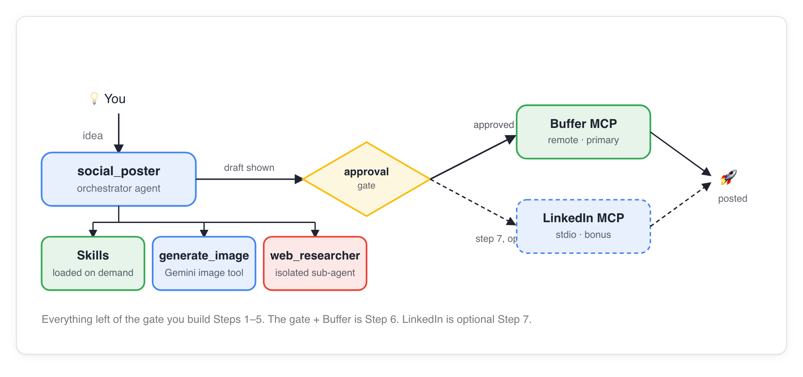

# Social Spark — GDG London AI DevCamp 2026

An autonomous, multi-turn AI social media agent that transforms an idea into a fully-researched, on-brand, and illustrated social post. It dynamically searches the web, drafts content in your authentic brand voice, generates image assets, enforces a **fail-safe human confirmation gate**, and publishes across LinkedIn and Buffer queues.

Built during the **GDG London Agentic DevCamp 2026** using the **Google Cloud Agent Development Kit (ADK)** and the **Gemini Enterprise Agent Platform**.

---

## Documentation Structure: Upstream Curriculum vs. Attendee Portfolio

This repository maintains a strict architectural distinction between the upstream workshop curriculum and our empirical implementation portfolio:

* **[Duncan's Walkthrough Portfolio & Engineering Analysis](https://duncmon.github.io/ai-devcamp-labs/) (`docs/`)**:  
  Published as our live GitHub Pages documentation. Contains step-by-step walkthroughs, **7 Architectural Decision Records (ADRs)**, **27+ empirical engineering post-mortems**, 87+ authentic verification screenshots, and dedicated educational guides (e.g. Twelve-Factor Backend Binding and Shell Script CLI Flag Parsing).
* **[Upstream Instructor Curriculum](docs/instructor/index.html) (`docs/instructor/`)**:  
  Authored by **Sonika Janagill** for GDG London. Preserves the original workshop codelabs, setup guides, and demonstration scripts (hosted upstream at [sonikajanagill.com/ai-devcamp-labs](https://sonikajanagill.com/ai-devcamp-labs/)).

---

## Architecture & How It Works



1. **Idea Intake**: The user submits a raw topic or thesis through the CopilotKit Next.js frontend or ADK web runner.
2. **Specialized Subagents & Skills**:
   - `research_agent`: Subagent equipped with `google_search` to discover current technical documentation without search-mixing collisions.
   - `draft_agent`: Formats drafts adhering to `skills/brand-voice/SKILL.md` via progressive disclosure.
   - `generate_image`: Synthesizes imagery with Gemini Imagen and outputs local PNGs plus IAM V4 signed Cloud Storage URLs.
3. **Hard Human Confirmation Gate**: The orchestrator strictly pauses before publishing. The approval gate is enforced at the framework level (`require_confirmation=True`), preventing model bypass.
4. **Dual-Publisher Routing**: Resolves immediate posts to LinkedIn dry-run logs and scheduled multi-channel queues to Buffer without tool declaration collisions (`POST_VIA=auto`).

---

## The 4 Platform Pillars

| Pillar & Lab | Upstream Lab Guide | Duncan's Walkthrough & Proof | Verified Checkpoints & Architectural Invariants |
| :--- | :--- | :--- | :--- |
| **Pillar 1: Build** | [`docs/instructor/lab-1-build.html`](docs/instructor/lab-1-build.html) | [**Lab 1 Walkthrough**](docs/lab-1.html) | **9 / 9 Verified (26 Figures)**. Dual-publisher routing (`POST_VIA=auto`, ADR-1), V4 signed URLs (ADR-2), in-flight stepper sync (ADR-5). |
| **Pillar 2: Scale** | [`docs/instructor/lab-2-scale.html`](docs/instructor/lab-2-scale.html) | [**Lab 2 Walkthrough**](docs/lab-2.html) | **9 / 9 Verified (12 Figures)**. Vertex AI Reasoning Engine deployment, cryptographic Agent Identity, scale-to-zero memory callback (ADR-7). |
| **Pillar 3: Govern** | [`docs/instructor/lab-3-govern.html`](docs/instructor/lab-3-govern.html) | [**Lab 3 Walkthrough**](docs/lab-3.html) | **9 / 9 Verified (8 Figures)**. Model Armor regional templates, pure-ASGI DLP domestic phone redaction (ADR-3), Agent Registry, 8/8 Red-Team block. |
| **Pillar 4: Optimise** | [`docs/instructor/lab-4-optimize.html`](docs/instructor/lab-4-optimize.html) | [**Lab 4 Roadmap**](docs/index.html) | **Active in `PROGRESS.md`**. Golden eval set hardening, simulated users (`simulate.py`), BigQuery Agent Analytics, Cloud Build eval gate. |

---

## Tech Stack

| Layer | Technology | Role & Architecture |
| :--- | :--- | :--- |
| **Agent Framework** | [Google ADK](https://google.github.io/adk-docs/) (Python) | Orchestrator, tools, subagents, durable sessions, and eval suites |
| **Foundation Models** | Gemini 3 Series (`gemini-3.8-flash`, `gemini-3.5-flash-lite`, `gemini-3.1-pro-preview`) | Specialization across orchestrator, research subagent, and drafting |
| **Agent Knowledge** | Agent Skills (`skills/`) | Brand voice and platform guidelines as versioned, reviewable Markdown |
| **Publishing MCPs** | Buffer (remote MCP) & LinkedIn (stdio MCP) | Real queue scheduling guarded behind framework confirmation gates |
| **Guardrails & Security** | Model Armor + Cloud DLP | Pure-ASGI HTTP boundary redaction & regional adversarial filter |
| **Backend API** | FastAPI + [`ag-ui-adk`](https://github.com/ag-ui-protocol/ag-ui) | Streams AG-UI SSE protocol to CopilotKit frontend at `/api/adk` |
| **Frontend** | Next.js 16, React 19, [CopilotKit](https://copilotkit.ai) | Live chat, interactive approval cards, real-time stage stepper |
| **Telemetry & Evals** | BigQuery Agent Analytics + Cloud Trace | OpenTelemetry instrumentation, event logging, and SQL analytics |
| **Package & Dev Tooling** | `uv`, `agents-cli`, `gcloud` | Fast dependency resolution, deployment, and testing |

---

## Running Locally

### 1. Prerequisites
- [uv](https://docs.astral.sh/uv/) (strictly required for Python operations)
- Node.js 20+ and `npm`
- Google Cloud project with Application Default Credentials configured (`gcloud auth application-default login`)

### 2. Setup Environment
```bash
# Clone the repository
git checkout duncan-lab3

# Configure environment secrets
cp .env.example backend/social_poster/.env
# Edit backend/social_poster/.env with your GOOGLE_CLOUD_PROJECT

# Sync Python virtual environment
uv sync
```

### 3. Start Backend
In **Terminal 1**, run the FastAPI AG-UI backend:
```bash
./run-backend.sh
# Serves AG-UI endpoint on http://localhost:8000
```

### 4. Start Frontend with Engineered CLI Flags
In **Terminal 2**, run the Next.js frontend launcher. The script supports pure-Bash flag parsing:

```bash
# Run against local backend (default: http://localhost:8000)
./run-frontend.sh --local

# Run against deployed Vertex AI Reasoning Engine (reads deployment_metadata.json)
./run-frontend.sh --cloud

# Display CLI launcher help
./run-frontend.sh --help
```

> **Visual Observability Badge:**  
> When the frontend loads on `http://localhost:3000`, the top header displays a dynamic `<BackendStatusBadge />`:
> - `● Local (:8000)`: Confirms active connection to local FastAPI runner.
> - `☁ Vertex AI (...)`: Confirms connection to deployed cloud Reasoning Engine.
> - `⚠ Unreachable`: Diagnostic state streaming actionable SSE recovery instructions.

Publishing defaults to dry-run mode (`DRY_RUN=true`), so no real external posts are published unless explicitly configured.

---

## Automated Verification & Tests

To execute regression tests across all tools, guardrails, and routing logic:
```bash
uv run pytest
```

---

## Repository Layout

```
ai-devcamp-labs/
├── docs/                        Duncan's Walkthrough Portfolio (GitHub Pages root)
│   ├── index.html               Portfolio homepage & bento navigation
│   ├── lab-1.html ... lab-3.html Lab walkthroughs with authentic traces
│   ├── learnings.html           27+ empirical engineering post-mortems
│   ├── backend-binding.html     Twelve-Factor backend binding architecture
│   ├── shell-script-flags.html  Standalone CLI flag parsing educational guide
│   ├── screenshots/             Authentic figures, console logs & traces (87 assets)
│   ├── .nojekyll                Disables Jekyll processing on GitHub Pages
│   └── instructor/              Upstream workshop curriculum (Sonika Janagill)
│       ├── index.html           Original instructor docs hub
│       ├── lab-1-build.html ... lab-4-optimize.html Upstream lab codelabs
│       ├── LEARNINGS.md         Instructor pre-flight notes
│       └── img/                 Original workshop architecture diagrams
├── backend/
│   ├── social_poster/           Orchestrator, subagents, tools, guardrails
│   ├── pii_middleware.py        Pure-ASGI Cloud DLP redaction middleware
│   ├── governance.py            POLA hierarchical project resolution CLI
│   └── main.py                  FastAPI server: AG-UI SSE route, memory & sessions
├── frontend/                    Next.js + CopilotKit UI
│   ├── app/lib/backend.ts       Deterministic Twelve-Factor backend binding
│   └── app/components/          Stage stepper, activity feed, status badge
├── evals/                       adk eval datasets, simulation scripts, SQL analytics
├── skills/                      Agent Skills (brand voice)
├── run-backend.sh               Backend launcher script
├── run-frontend.sh              Frontend launcher with --local and --cloud CLI flags
└── PROGRESS.md                  Authoritative master memory charter & action plan
```

---

## Live Walkthrough Portfolio

The full interactive portfolio is available online via GitHub Pages:  
👉 **[https://duncmon.github.io/ai-devcamp-labs/](https://duncmon.github.io/ai-devcamp-labs/)**
