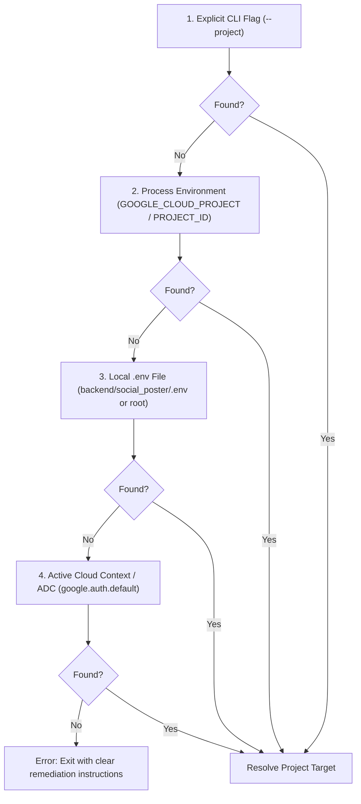

# Lab 3: Govern — Learnings & Difficulties Encountered

This document records the end-to-end work through of **Lab 3 (Govern)** for the GDG London AI DevCamp (`Social Spark`). It captures our direct attendee learnings, difficulties encountered, architectural reflections, and solutions—maintaining a clear separation between our participant experience and the instructor notes in `docs/LEARNINGS.md`.

---

## 1. Executive Summary & 5-Line Rundown

1. **Model Armor Ingress & Egress:** Screened LLM prompts and responses against prompt injection, jailbreaks, and harmful content using regional `devcamp-guardrails` templates.
2. **Fail-Closed Boundary Redaction:** Implemented pure-ASGI `RedactUserMessages` middleware to redact user PII via Cloud DLP *before* prompts touch the agent or session store.
3. **Multi-Country Domestic Phone Detection:** Overcame Cloud DLP's limitation on domestic phone numbers by augmenting inspection with multi-country custom regex detectors.
4. **Agent Runtime & Playground Compatibility:** Repaired the `/api/stream_reasoning_engine` contract to resolve Google Cloud Console Playground `400` errors and handle full GCP session resource paths.
5. **Agent Registry & Enterprise Governance Architecture:** Verified auto-registration of `social-spark-poster` with cryptographic `RuntimeIdentity`, dynamic MCP catalog search (`bigquery`), and contrast against static wikis. Re-architected `backend/governance.py` with multi-tier fallback resolution.

---

## 2. Key Difficulties Encountered & Solutions

### Issue 1: Configuration Resolution Anti-Pattern & Principle of Least Astonishment
- **Symptom:** Running the Step 5 command from the lab guide:
  ```bash
  uv run python backend/governance.py registry-agents
  ```
  abruptly exited with:
  ```
  Set GOOGLE_CLOUD_PROJECT to your GCP project ID (export GOOGLE_CLOUD_PROJECT=...).
  ```
- **Context & Genesis:**
  - Throughout Labs 1, 2, and earlier in Lab 3, project configuration lived in `backend/social_poster/.env`.
  - `backend/governance.py` was authored separately as a standalone administrative REST tool. Unlike `main.py`, it omitted `dotenv.load_dotenv()` and strictly required `os.environ.get("GOOGLE_CLOUD_PROJECT")`.
  - Furthermore, the instruction to `export GOOGLE_CLOUD_PROJECT=YOUR_PROJECT` was deferred to Step 6 of the documentation, leaving Step 5 broken when attendees copied the snippets directly.
  - In POSIX shells (bash/zsh), setting a local variable (`GOOGLE_CLOUD_PROJECT=...`) without `export` does not propagate to child processes (`uv run`), producing confusing errors for participants who thought the variable was already set.
- **Architectural Reflection:**
  - *The Anti-Pattern:* Breaking an established project convention (moving from automated `.env` loading to a required manual shell export) while deferring the explanation to a later step violates the **Principle of Least Astonishment**. Abruptly exiting creates needless friction.
  - *The Ideal Pattern:* Administrative CLIs should implement a **predictable resolution hierarchy**:



- **Solution & Implementation:**
  Updated [`backend/governance.py`](../backend/governance.py) to implement this resilient fallback chain:
  ```python
  # 1. Automatically load backend/social_poster/.env or root .env
  _env_path = pathlib.Path(__file__).parent / "social_poster" / ".env"
  if _env_path.exists():
      load_dotenv(_env_path)
  elif (pathlib.Path(__file__).parents[1] / ".env").exists():
      load_dotenv(pathlib.Path(__file__).parents[1] / ".env")

  # 2. Check GOOGLE_CLOUD_PROJECT or PROJECT_ID
  PROJECT = os.environ.get("GOOGLE_CLOUD_PROJECT") or os.environ.get("PROJECT_ID")

  # 3. Fallback to active Application Default Credentials (ADC)
  if not PROJECT:
      try:
          _, adc_project = google.auth.default()
          PROJECT = adc_project
      except Exception:
          pass

  # 4. Fail closed with remediation message
  if not PROJECT:
      sys.exit("Set GOOGLE_CLOUD_PROJECT to your GCP project ID (export GOOGLE_CLOUD_PROJECT=...).")
  ```

  **How and Why It Works:**
  1. `pathlib.Path(__file__).parent / "social_poster" / ".env"` dynamically anchors the file path relative to the script itself, ensuring the configuration is located regardless of where the developer runs the command from (repo root, `backend/`, or subdirectories).
  2. `dotenv.load_dotenv()` populates `os.environ` *without* overwriting any pre-existing variables. This preserves the developer's ability to override settings from the terminal when desired.
  3. `google.auth.default()` introspects the active gcloud authentication context. When a developer has run `gcloud auth application-default login`, their active quota/billing project is already known locally, allowing the CLI to operate with zero manual configuration.

- **Discussion: When to Choose Between Configuration Approaches**

  | Approach | How It Operates | When to Choose | Trade-offs & Failure Modes |
  | :--- | :--- | :--- | :--- |
  | **Multi-Tier Hierarchical Fallback** | Code systematically checks flags $\to$ env vars $\to$ local `.env` $\to$ ADC. | **Best for application code, SDKs, and developer-facing CLIs.** Highly recommended in workshops and shared codebases where ergonomics and the Principle of Least Astonishment matter. | Requires minimal extra glue code (`dotenv`, `pathlib`). Can mask issues if a user accidentally runs against an unexpected default project when multiple accounts exist. |
  | **Inline Variable Execution** (`PROJECT=... uv run ...`) | Variable is set exclusively for the lifetime of that single command process. | **Best for one-off testing, ad-hoc overrides, CI/CD pipeline steps, or comparing behaviors** (e.g., toggling `PII_REDACTION=on/off`). | High terminal typing overhead; easy to typo; leaves no persistent state across consecutive commands. |
  | **Explicit Shell Export** (`export PROJECT=...`) | Variable is placed into the current shell environment and inherited by all child processes. | **Best for dedicated, long-lived terminal sessions** focused on a single deployment target, or when executing complex multi-step bash scripts. | Easily forgotten across terminal tabs; in bash/zsh, beginners often set local shell variables (`PROJECT=...`) without `export`, which silently fails to pass down into `uv run`. |

---

### Issue 2: Cloud DLP Telephone Number Detection on Domestic Formats
- **Symptom:** In natural pseudo-posts (e.g., *"Reach me, Daniel Okonkwo, at daniel.okonkwo@example.com or 020 7946 0000 to talk about the workshop"*), Cloud DLP successfully redacted names and emails, but left domestic phone numbers (`020 7946 0000`) untouched.
- **Root Cause:**
  Cloud DLP's built-in `PHONE_NUMBER` infoType relies heavily on international E.164 prefixes (`+44...`) or adjacent telephony context hotwords (`tel`, `call`, `phone`). In natural sentences where phone numbers appear without explicit prefixes, DLP rates domestic formats as `VERY_UNLIKELY` or misses them entirely.
- **Solution:**
  In `backend/social_poster/guardrails.py`, implemented Google Cloud DLP's overlapping custom detector pattern:
  - Added a multi-country regex covering domestic UK, France (`03...`), China (`13...`), and Argentina (`011...`) formats.
  - Attached this regex as a `custom_info_types` rule overriding the `PHONE_NUMBER` infoType.
  - Verified 100% redaction across all test cases without degrading name or email detection.

---

### Issue 3: Console Playground Execution 400 Error (`Status: 400 Error code: 3`)
- **Symptom:** Submitting queries in the Google Cloud Console Agent Platform Playground failed with:
  ```
  Reasoning engine execution failed: Status: 400 Error code: 3
  ```
- **Root Cause:**
  - The Console Playground calls the native `reasoningEngines:streamQuery` RPC, which routes to `/api/stream_reasoning_engine`.
  - The initial implementation in `backend/main.py` enforced rigid payload checking (`payload["input"]["message"]`) and static type hinting, causing FastAPI `422` or `400` errors when the Playground passed `query`, `prompt`, or structured `Content` objects.
  - Additionally, the Console Playground passed full Google Cloud session resource names (`projects/.../locations/.../sessions/5220770002281431040`), which broke ADK's `session_service` when looking up local session IDs.
- **Solution:**
  - Mounted `/stream_reasoning_engine` alongside `/api/stream_reasoning_engine`.
  - Used `request: Request` with dynamic JSON extraction to unwrap text from string inputs, dictionaries, and structured `Content` parts.
  - Added session path sanitization: `session_id = raw_session.split('/')[-1]`.
  - Maintained fail-closed boundary PII redaction on all extracted text.

---

### Issue 4: Pure-ASGI Middleware Streaming Disconnect Loop
- **Symptom:** Chat responses over streaming channels spun indefinitely or hung.
- **Root Cause:**
  When replacing `receive()` in a pure-ASGI middleware to replay a redacted request body, a streaming HTTP connection expects `receive()` to yield the body once and subsequently listen for disconnect events. Replaying the body continuously causes the ASGI disconnect listener to spin in a tight loop.
- **Solution:**
  In `backend/pii_middleware.py`, implemented a single-handover flag in the wrapped `receive()` coroutine, delegating subsequent calls to `await receive()` from the underlying ASGI channel.

---

### Issue 5: Syntactic Redaction vs. Semantic Understanding (DLP Over-Redaction)
- **Symptom:** Benign public or historical names (e.g., *Marie Curie* in our French test case) were scrubbed to `[PERSON_NAME]`.
- **Learning:**
  - Cloud DLP is a syntactic, token-based classifier. It matches lexical patterns and name gazetteers; it cannot evaluate whether an entity is a private citizen or a historical figure.
  - In data governance, a **false negative** (leaking real customer PII) carries regulatory penalties, whereas a **false positive** (redacting a famous figure) is cosmetic.
  - Boundary layers should remain simple, fast, and fail-closed. Semantic exceptions must be handled by application allowlists or downstream agent reasoning.

---

### Issue 6: Agent Registry vs. The 50-Agent Static Wiki Problem (Step 5 Checkpoint)
- **Checkpoint Context:**
  Running `backend/governance.py registry-agents` listed `social-spark-poster`, and `registry-search "bigquery"` queried Google Cloud's MCP catalog, returning BigQuery's MCP server with 9 tools.
- **Architectural Question:**
  *What does an Agent Registry give an enterprise with 50+ autonomous agents that an internal wiki page (Confluence, Notion) cannot?*
- **Enterprise Capabilities Analysis:**
  1. **Cryptographic Identity Binding (RuntimeIdentity):**
     A wiki page is passive text. An Agent Registry entry is tied to a Google Cloud cryptographic principal (`principal://agents.global...`). This allows IAM access control, audit logging, and Governance Policies to bind directly to the running agent, preventing spoofing.
  2. **Programmatic & Autonomous Discovery:**
     Agents themselves cannot reliably navigate human-formatted wiki tables to find dependencies. Agent Registry exposes semantic vector search APIs (`/mcpServers:search`), allowing orchestrator agents to dynamically discover tool capabilities (e.g., finding the BigQuery MCP server) at runtime.
  3. **Live State & Health vs. Documentation Drift:**
     Wiki pages degrade into "documentation debt" within weeks of deployment. The Registry reflects live deployment state, active container endpoints, and operational status automatically upon deployment.
  4. **Strict Schema Contracts & Versioning:**
     The registry enforces structured tool schemas and MCP interface contracts. When an MCP server updates its tool signatures or parameters, consumers discover versioned contracts rather than relying on stale markdown descriptions.
  5. **Granular RBAC & Policy Enforcement:**
     With a central registry, security teams can enforce organization-wide governance policies (e.g., *“No agent may call BigQuery write tools without manager approval”*). A wiki page has no policy enforcement hook.
  6. **Telemetry & Auditability:**
     Every discovery query, tool invocation, and security finding links back to the registered agent ID across Cloud Logging, Cloud Trace, and Security Command Center.

---

### Issue 7: Governance Policies: Semantic Constraints vs. Runtime Enforcement (Step 6 Checkpoint)
- **Checkpoint Context:**
  Provisioned the singleton `semanticGovernancePolicyEngine` in `us-central1` and created policy `no-unapproved-posts` (*"The agent must never publish a social post without explicit human approval"*). Verified policy existence with `uv run python backend/governance.py list`, resolving to `identity: principal://agents.global.proj-498585195540.system.id.goog/resources/aiplatform/projects/498585195540/locations/us-central1/reasoningEngines/1836136314752204800`.
- **Crucial Architectural Learning (Existence != Enforcement):**
  - **What the policy does:** It establishes a cloud-managed, versioned semantic intent bound to the agent's cryptographic identity principal in Google Cloud. It is visible in the Cloud Console under **Agent Platform > Govern > Policies > Business policies**.
  - **What actually enforces the block:** If a user instructs the agent to publish a social post without approval, **the agent is blocked by the application code approval gate (`require_confirmation=True` on the posting tool in ADK), NOT by the governance policy.**
  - **Why the policy does not actively enforce yet:** Active runtime enforcement by the policy engine requires:
    1. An Agent Gateway with client-to-agent ingress routing.
    2. A dedicated VPC network and DNS zone for the engine (`--gateway-config`).
    3. An authorization extension and policy targeting Gemini `:generateContent` calls.
    Without this enterprise network harness, the policy exists and binds cryptographically, but does not intercept execution. Conflating policy existence with runtime enforcement is a common trap in early governance rollouts.

---

### Issue 8: Agent Gateway Ingress vs. Custom Routes & The 8MB Quota Trap (Step 7 Checkpoint)
- **Checkpoint Context:**
  Configured an Agent Gateway (`agw-social-spark`), Service Extension (`agw-social-spark-authz-modar`), and Authz Policy (`agw-social-spark-authz-policy-modar`) targeting Model Armor in `us-central1`. Bound the deployed Reasoning Engine agent `social-spark-poster` (`1836136314752204800`) to this gateway via `--agent-gateway-ingress`.
- **The 8MB Request Payload Quota Trap (`.gcloudignore`):**
  - **Symptom:** When running `agents-cli deploy`, the deployment crashed with:
    `google.api_core.exceptions.InvalidArgument: 400 Request payload size exceeds the limit: 8388608 bytes.`
  - **Root Cause:** Vertex AI Reasoning Engine API (`reasoningEngines.create` / `patch`) accepts the source archive as an in-memory base64 JSON payload capped strictly at 8MB. As project documentation, tests, and visual screenshots accumulated in `docs/screenshots/` (>11MB), `agents-cli` automatically bundled them into the deployment tarball.
  - **Solution:** Added a root `.gcloudignore` file excluding non-runtime artifacts:
    ```
    docs/
    frontend/
    evals/
    *.png
    *.svg
    *.jpg
    *.jpeg
    node_modules/
    .git/
    .venv/
    ```
    This reduced the deployment payload to <50KB, ensuring fast and deterministic deployments without quota errors.
- **Fail-Open vs. Fail-Closed Security Posture (`failOpen: false`):**
  - The Service Extension specifies `failOpen: false` with a `timeout: 5s`.
  - **Architectural Tradeoff:** With `failOpen: true`, any network partition, transient timeout, or configuration error in the Model Armor backend allows potentially malicious user prompts to proceed directly to the agent LLM. By setting `failOpen: false`, the architecture enforces a secure-by-default posture: if guardrail inspection cannot be guaranteed, the request fails fast with an explicit error rather than silently bypassing inspection.
- **Edge Screening Proof: Native `streamQuery` vs. Custom Application Routes:**
  - **1. Native Protocol Ingress (`streamQuery`, MCP, A2A):**
    When calling the Reasoning Engine endpoint natively (`POST ...:streamQuery`) with a DAN injection prompt, the Agent Gateway intercepted the request before container invocation and returned:
    ```http
    HTTP/2 403 Forbidden
    {
      "code": 403,
      "message": "Model Armor: Prompt violates content security configurations",
      "status": "PERMISSION_DENIED"
    }
    ```
    The Reasoning Engine container was never spun up; zero token generation occurred. A benign query returned `HTTP/2 200 OK` with streaming NDJSON events, confirming zero false positives.
  - **2. Custom Application Routes (`/api/adk` via Web UI):**
    When the web application UI communicates over its custom Express/FastAPI `/api/adk` bridge, the traffic flows directly into the agent service container, bypassing the Agent Gateway ingress layer completely.
    - Here, defense relies on **in-agent pre-execution callbacks** (`probe_template.py` / Model Armor client in Python code), returning the friendly application response:
      *`"I can't help with that request — it was flagged by our content safety checks."`*
- **Enterprise Best Practice & Cost Recommendations:**
  1. **Defense in Depth (Network Edge + In-Agent):**
     Gateways protect standards-compliant protocols (A2A, MCP, native `streamQuery`). Internal custom application routes require complementary application-layer middleware. Never rely solely on an ingress proxy when custom API paths exist.
  2. **Cost & Latency Optimization:**
     Blocking malicious payloads at the Agent Gateway costs ~$0.001 per Model Armor call and zero LLM generation tokens. Letting attacks reach the agent incurs compute container execution cost, Gemini input/output token pricing, and cold-start latency. Edge inspection provides substantial cost reduction during automated red-teaming or volumetric attack attempts.

---

## 3. Screenshots Walkthrough

All verification screenshots are stored in [`docs/screenshots/`](screenshots/):

| Screenshot | Stage / Step | Description |
|---|---|---|
| `step2-model-armor-probe.png` | **Step 2: Model Armor Template Validation** | Direct evaluation of `devcamp-guardrails` via `probe_template.py` (10/10 passed) and `:sanitizeUserPrompt` curl showing `MATCH_FOUND` on DAN jailbreak. |
| `step3-governance-eval.png` | **Step 3: Deployed Agent Guardrail Check** | Terminal verification running `./evals/run.sh evals/governance.json` showing `PASSED` when guardrails are on, and `FAILED` when `MODEL_ARMOR_TEMPLATE_ID=off`. |
| `step4-dlp-redaction.png` | **Step 4: Boundary PII Redaction** | Terminal output demonstrating Cloud DLP redaction of names, emails, and domestic phone numbers. |
| `step4-multicountry-dlp.png` | **Step 4: International Testing** | Multi-country validation verifying domestic phone number detection for UK, France, China, and Argentina. |
| `step4-playground-traces.png` | **Step 4: Console Telemetry** | Vertex AI Console Playground Trace view showing end-to-end execution, span breakdown, and `redact_pii_text` latency (175ms). |
| `step4-playground-events.png` | **Step 4: Console Event Flow** | Console Playground chat event stream showing successful query execution and the agent's PII-sanitized response. |
| `step5-agent-registry.png` | **Step 5: Agent Registry & Search** | Terminal capture of `registry-agents` (verifying `social-spark-poster` identity) and semantic `registry-search "bigquery"` (returning BigQuery MCP server with 9 tools). |
| `step6-governance-policy.png` | **Step 6: Policy Engine & Identity Binding** | Terminal output showing policy engine provisioning (`ACTIVE`), policy creation (`no-unapproved-posts`), and cryptographic binding to runtime identity. |
| `step6-console-business-policies.png` | **Step 6: Console Business Policies Tab** | Google Cloud Console view under Agent Platform > Govern > Policies > Business policies showing `no-unapproved-posts` registered and bound to `social-spark-poster`. |
| `step6-console-policy-details.png` | **Step 6: Console Policy Details Drawer** | Slide-out drawer in Cloud Console displaying natural language constraint, target agent registry resource URI, and scope (`All tools`, `All MCP servers`). |
| `step7-agent-gateway.png` | **Step 7: Agent Gateway Ingress & Authz Extension** | Verification of Gateway binding (`agw-social-spark`), native `streamQuery` 403 edge rejection vs. 200 benign pass, and custom `/api/adk` route in-agent defense. |


